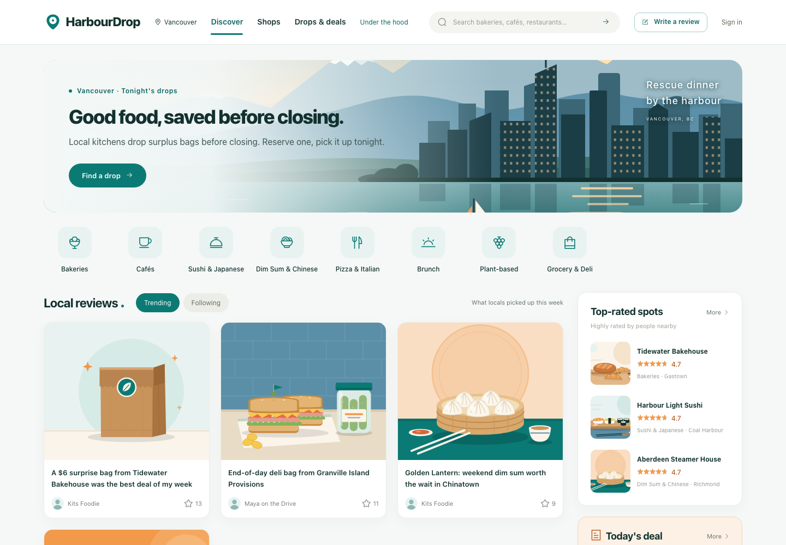
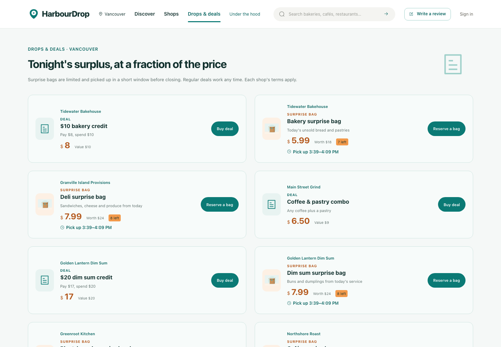
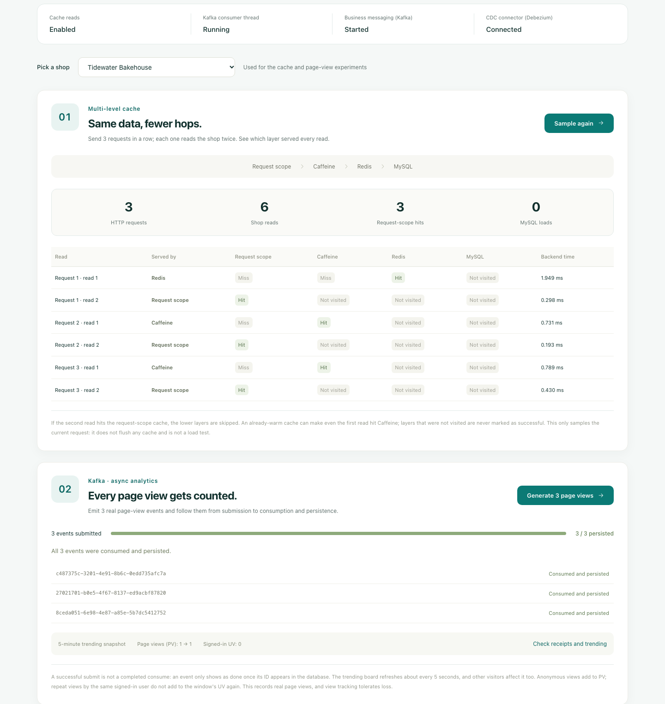
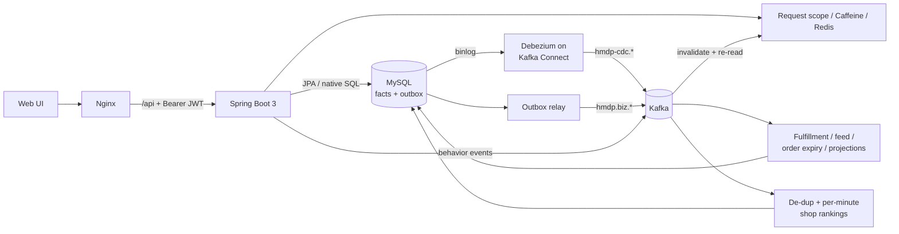

# HarbourDrop — Surplus-Food Drops & Restaurant Deals in Vancouver

**English** · [简体中文](README.zh-CN.md)

Vancouver restaurants, cafés and bakeries post a small number of **surprise bags** of unsold food before closing; people reserve one and pick it up in a short **pickup window**. Shops also offer regular **deals**, and diners leave reviews, follow each other and get a feed.

Drops sell out in minutes, so the Spring Boot 3 backend is built to stay **correct under concurrency and partial failure**: no overselling, no duplicate orders, no lost background work, and no stale cache entries after updates.


| Home | Tonight's drops and deals |
| --- | --- |
|  |  |



The "Under the hood" page calls the real APIs. Above, three requests each read a shop twice: the first read came from Redis, later ones from Caffeine or the request-scope cache, and none reached MySQL. Three page-view events were then followed through Kafka until each was persisted. The same page also tracks an order's outbox/inbox progress.

## Highlights

| Problem | Approach |
| --- | --- |
| Work lost if the app crashes between a DB commit and a message send | **Transactional outbox**: the business row and the event are written in one MySQL transaction; a relay claims batches with `FOR UPDATE SKIP LOCKED` and lease fencing, then publishes to Kafka |
| Duplicate side effects from at-least-once delivery | **Inbox de-duplication** in the same transaction as the business update; failures retry with backoff, then quarantine or dead-letter |
| Overselling and double claims when a drop opens | **Two phases**: an atomic Redis Lua script admits the request and appends to a Redis Stream; fulfillment later applies a conditional `stock > 0` update in MySQL, with identity checks before any compensation |
| Stale cache after concurrent updates, including direct SQL edits | **Version fencing** plus owner-checked fill scripts, so a slow loader cannot overwrite newer data; **Debezium CDC** invalidates caches from the MySQL binlog |
| Hot keys hammering the database | **Four read layers** (request scope → Caffeine → Redis → MySQL) with null caching and single-flight rebuild |
| Stateless auth that can still log users out | **Spring Security + JWT**: 15-minute access tokens, refresh tokens stored only as hashes and rotated on every use, and revocation via a `jti` deny-list |

## Architecture



It is a single deployable service organized by responsibility (`controller`, `service`, `repository`, `security`, `cache`, `messaging`, `analytics`), not a set of microservices.

## Engineering decisions

**A drop is a flash sale with a pickup window.** Surprise bags reuse the flash-sale path end to end (Redis admission, Stream hand-off, Kafka fulfillment); migration V11 adds an optional pickup window that is validated on creation and returned with vouchers and orders. In the demo, [`DemoDropServiceImpl`](src/main/java/com/hmdp/service/impl/DemoDropServiceImpl.java) republishes a drop for a few seeded shops whenever theirs has ended or sold out, through the same outbox publication path an admin uses ([`DemoDropIntegrationTest`](src/test/java/com/hmdp/service/DemoDropIntegrationTest.java)).

**Times are stored in UTC and shown in Vancouver time.** The JVM and MySQL run in UTC; the web client parses server timestamps as UTC and renders them with the IANA `America/Vancouver` zone, so the UI follows whatever daylight-saving rules the browser's time-zone data has.

**Kafka has no per-message delay, so the outbox is the timer.** Unpaid orders must close after 30 minutes. Instead of a broker feature, the relay defers any event whose `deliver_at` is in the future and publishes it once due. The expiry handler then closes the order with a conditional update, so a payment that wins the race is never overwritten. See [`OutboxRelayServiceImpl`](src/main/java/com/hmdp/service/impl/OutboxRelayServiceImpl.java), verified by [`KafkaBusinessIntegrationTest`](src/test/java/com/hmdp/messaging/KafkaBusinessIntegrationTest.java).

**One Kafka topic per consumer group, keyed by aggregate ID.** Each logical consumer gets `hmdp.biz.<group>` plus a dead-letter topic. Keying by aggregate ID keeps one order's events ordered within a partition. Offsets are committed only after the database work and inbox record commit. See [`KafkaBusinessTransport`](src/main/java/com/hmdp/messaging/KafkaBusinessTransport.java).

**CDC triggers a re-read; it never writes event payloads into the cache.** Replayed or out-of-order binlog events would otherwise resurrect old values. Each batch is applied, checkpointed, then committed; a failed batch is retried, never skipped. See [`DebeziumCacheConsumer`](src/main/java/com/hmdp/cache/DebeziumCacheConsumer.java), verified against a real Debezium container in [`CacheCdcIntegrationTest`](src/test/java/com/hmdp/cache/CacheCdcIntegrationTest.java).

**Explicit inserts instead of `save()`.** Order IDs are generated before insert, and Spring Data's `save()` merges entities that already have an ID, which would turn a duplicate insert into a silent update. [`InsertRepository.insert()`](src/main/java/com/hmdp/repository/InsertRepository.java) always issues an INSERT and flushes, so unique-key conflicts surface at the call site. Locking reads and conditional updates stay as native SQL with affected-row checks.

## Bugs found and fixed

Each fix is committed with a regression test.

- **Admin check bypass.** Prefix rules ran on the raw URI, while Spring MVC routes on a normalized path, so a logged-in user could reach admin endpoints via paths like `/ops;x/...`. Rules now use the normalized path and ambiguous URIs are rejected ([`AccessGuardTest`](src/test/java/com/hmdp/reliability/AccessGuardTest.java), [`SecurityIntegrationTest`](src/test/java/com/hmdp/security/SecurityIntegrationTest.java)).
- **Read-only query rows after the ORM migration.** Spring Data returns immutable tuple maps where MyBatis returned `HashMap`, which broke an endpoint that enriches a row. Found during end-to-end testing; repositories now return mutable copies, enforced by an ArchUnit rule ([`RepositoryRowsIntegrationTest`](src/test/java/com/hmdp/repository/RepositoryRowsIntegrationTest.java)).
- **Login codes in logs.** Without SMTP, one-time codes were written to debug logs. Delivery now fails closed unless an explicit demo flag is set, and addresses are masked ([`LoginCodeSenderTest`](src/test/java/com/hmdp/security/LoginCodeSenderTest.java)).
- **False backlog alerts.** Not-yet-due order expirations were counted as outbox backlog. Pending work and scheduled work are now separate metrics.

## Testing

```bash
./mvnw verify   # Checkstyle + unit + integration tests; needs only a running Docker
```

- **Real dependencies, no mocks at the boundary.** [Testcontainers](src/test/java/com/hmdp/support/IntegrationTestBase.java) starts MySQL, Redis and Kafka once per test JVM. The CDC test adds a real Debezium Connect container.
- **Every native SQL statement is executed** against MySQL (119 queries, writes rolled back) by [`NativeQuerySmokeIntegrationTest`](src/test/java/com/hmdp/repository/NativeQuerySmokeIntegrationTest.java), because Hibernate does not validate native SQL at startup.
- **Architecture rules** with ArchUnit: only the repository layer touches SQL, controllers depend only on service interfaces, and native query parameters must match their bindings ([`ArchitectureTest`](src/test/java/com/hmdp/ArchitectureTest.java)).
- **Concurrency and failure scenarios**: last-unit contention, duplicate delivery, stream message takeover after a consumer crash, and stale cache fills ([`ReliabilityIntegrationTest`](src/test/java/com/hmdp/reliability/ReliabilityIntegrationTest.java)).

Result on 2026-11-12: 113 backend tests and 17 frontend tests passing, none skipped.

## Tech stack

| Area | Technology |
| --- | --- |
| Language & framework | Java 21, Spring Boot 3.5 |
| Persistence | MySQL 8, Spring Data JPA (Hibernate 6), Flyway |
| Caching & coordination | Redis 7, Redisson, Caffeine |
| Messaging & CDC | Apache Kafka 3.9, Spring for Apache Kafka, Debezium 3.7 (Kafka Connect) |
| Security | Spring Security 6 (OAuth2 resource server, JWT), email one-time codes |
| Testing | JUnit 5, Testcontainers, ArchUnit, Mockito |
| Observability | Micrometer, Prometheus, Alertmanager, OpenTelemetry, Jaeger |
| Runtime | Docker Compose, Nginx; frontend in Vue 2 |

## Quick start

Requires Docker with Compose v2. All images run natively on x86-64 and Apple Silicon.

```bash
docker compose -p harbourdrop -f dev/docker-compose.yml up -d
```

| URL | What |
| --- | --- |
| http://127.0.0.1:8080 | Web UI |
| http://127.0.0.1:8080/vouchers.html | Tonight's drops and deals |
| http://127.0.0.1:8080/experience.html | Under-the-hood verification page |
| http://127.0.0.1:8025 | Mailpit inbox for login codes |
| http://127.0.0.1:8081/actuator/health | API health |

Sign in with a seeded account such as `user1@example.com`; the code arrives in Mailpit. A few seeded shops always have a live drop (`HMDP_DEMO_DROPS_ENABLED=true` in the dev stack). To enable tracing, add `HMDP_TRACING_ENABLED=true` and `--profile observability`, then open Jaeger at http://127.0.0.1:16686.

## Project structure

```text
src/main/java/com/hmdp/
  controller/   REST endpoints
  service/      business logic and transactions
  repository/   Spring Data repositories (native SQL where locking matters)
  security/     JWT issuing, rotation, revocation; route rules
  cache/        multi-layer cache client, Debezium consumer
  messaging/    outbox relay transport on Kafka
  analytics/    behavior events and shop rankings
  reliability/  flash-sale recovery, rate limiting, operations
src/main/resources/db/migration/   Flyway migrations
src/test/                          unit, architecture and Testcontainers tests
dev/                               Compose stack, Debezium connector, monitoring
```

## Scope and limitations

- Starts from a well-known Spring Boot course scaffold (Heima Dianping), re-themed as a Vancouver product. The reliability, caching, messaging, security and testing layers described above extend that base; `hmdp` remains the internal code name in packages and configuration.
- All shops, people and reviews are fictional. Shop coordinates are real Vancouver-area neighbourhoods; photos are from Unsplash ([credits](frontend/assets/photos/CREDITS.md)) and do not depict the fictional shops.
- Runs as a single-node Docker Compose stack. There is no multi-node high availability, disaster recovery or production traffic, and no load-test results are published for the current version.
- Payment is a disabled-by-default local simulation. Real payments, refunds and SMS are out of scope.

## Documentation

A detailed design walkthrough (13 chapters plus an API and data appendix, in Chinese) is in the [wiki](wiki/README.md).
