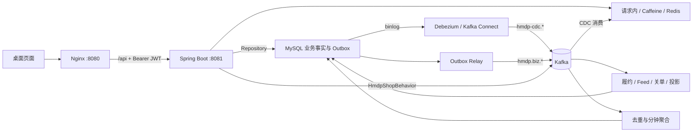

# HarbourDrop — 温哥华剩余食物惊喜袋与餐饮优惠（原黑马点评扩展项目）

[English](README.md) · **简体中文**

> 业务已改为温哥华本地主题：餐厅和面包店在打烊前限量发布“剩余食物惊喜袋”（原秒杀券，V11 增加取货时间窗），另有常规餐饮优惠（原普通券）。界面与接口文案为英文，店铺、用户和评价均为虚构数据。下文保留原有技术说明，“秒杀券 / 普通券 / 探店笔记”分别对应界面上的 drop / deal / review。

基于 Spring Boot 3 的本地生活平台，包含店铺搜索、探店笔记、点赞关注、签到、普通领券、异步秒杀和个人订单。在课程业务基础上，增加四层查询缓存、Debezium 数据变更同步、Kafka 可靠业务消息与行为分析、订单超时关闭、JWT 登录及网页体验验证。

技术栈按北美主流后端组合构建：Java 21、Spring Boot 3.5、Spring Data JPA、Spring Security（JWT）、Kafka、Debezium、Testcontainers、OpenTelemetry。项目面向 Java 后端学习与面试实践：既能从页面完成业务操作，也能沿 Controller → Service → Repository 阅读实现，结合容器化集成测试理解并发、幂等、事务和故障恢复。

**详细教程：[项目 Wiki](wiki/README.md)**。包含 13 章和接口附录，按业务问题、方案推导、源码讲解、操作验证与常见问题展开。

## 业务功能

| 模块 | 当前功能 |
| --- | --- |
| 用户与登录 | 邮箱验证码登录（首次自动注册）、JWT 访问令牌、刷新令牌轮换、注销吊销、本人资料、登录限流 |
| 店铺与搜索 | 分类、商圈、关键词、价格、评分、优惠券筛选、附近商家与分页排序 |
| 探店社区 | 发布笔记、图片上传、点赞状态、关注关系、共同关注与关注动态 |
| 签到 | 按月 Bitmap 签到、当前月截至今天的连续签到天数 |
| 优惠券与订单 | 普通领券、一人一单、订单快照、本人订单、未付款普通订单取消 |
| 秒杀 | 活动发布、Lua 预占、异步履约、请求状态、指定补偿与库存对账 |
| 行为分析 | 浏览、订单及模拟付款事件，5/60 分钟商家热榜 |
| 体验与运维 | 缓存路径、Kafka 持久回执、本人订单任务进度、管理员复核、指标与链路追踪 |

配套桌面页面位于 [frontend](frontend)，调用本项目 Java 接口。

## 核心技术亮点

| 亮点 | 解决的问题 | 当前实现 | 详细讲解 |
| --- | --- | --- | --- |
| 四层查询链路 | 热点重复查询与集中回源 | 请求内缓存 → Caffeine → Redis → MySQL；空值缓存、同键加载合并、互斥重建 | [缓存](wiki/05-五层缓存与一致性.md) |
| 缓存一致性 | 更新后旧加载重新回填 | 版本与锁 owner 校验、源到期时间、事务 Outbox 失效、Debezium CDC 补充直接数据库变更 | [缓存](wiki/05-五层缓存与一致性.md)、[CDC](wiki/06-Canal与数据库变更同步.md) |
| 普通券幂等 | 双击重复建单与历史价格变化 | 用户锁、稳定数据库槽位、事务、订单金额与规则快照 | [订单](wiki/07-优惠券与订单生命周期.md) |
| 异步秒杀 | 超卖、重复资格与服务中断 | Lua 入口预占、Stream pending 接管、持久预约、Outbox 交接、条件扣库存 | [秒杀](wiki/08-秒杀Lua与RedisStream.md) |
| 精确补偿与复核 | 旧失败释放新订单资格 | 核对 userId/voucherId/orderId、幂等补偿、REVIEW、死信与只读对账 | [秒杀恢复](wiki/08-秒杀Lua与RedisStream.md) |
| 可靠业务消息 | 提交后任务丢失、重复投递与工作者竞争 | 业务与 Outbox 同事务、`SKIP LOCKED` 租约认领、owner 条件写回、退避重投、Inbox 去重；Kafka 按消费组分 topic，失败隔离或进入 DLT | [可靠消息](wiki/09-RocketMQ可靠消息.md) |
| 延迟关单 | 未付款订单长期占用业务状态 | 到期时间存于 Outbox，到点才由 Relay 发往 Kafka；条件状态迁移；数据库定期扫描兜底 | [订单](wiki/07-优惠券与订单生命周期.md)、[消息](wiki/09-RocketMQ可靠消息.md) |
| Kafka 分析 | 统计阻塞请求、重放重复累计 | 有界浏览采集、订单分析 Outbox、eventId 去重、事务聚合、提交数据库后确认 offset | [行为分析](wiki/10-Kafka行为分析与热榜.md) |
| 社区可靠性 | 重试切换点赞、Feed 分页遗漏、图片删除竞争 | 明确点赞状态、持久关系、分批 Feed 续传、时间游标与 offset、图片归属和引用锁 | [社区](wiki/11-社区搜索与页面验证.md) |
| 无状态认证 | 会话共享、令牌泄露与权限绕过 | Spring Security 资源服务器、15 分钟 HS256 JWT、哈希存储且一次性的刷新令牌、注销 jti 拒绝列表、按请求计算管理员角色 | [登录权限](wiki/04-登录权限与签到.md) |

MySQL 保存大部分持久业务事实，缓存保存查询副本，Outbox 保存可恢复任务。Redis 还承担验证码、刷新令牌、签到和秒杀入口预占，这些内容并非全部能从 MySQL 重建。

## 技术栈与架构

| 分类 | 组件 |
| --- | --- |
| Java 后端 | Java 21、Spring Boot 3.5、Spring Data JPA（Hibernate 6） |
| 安全 | Spring Security 6（OAuth2 资源服务器、JWT）、邮件验证码 |
| 数据与迁移 | MySQL 8、Flyway |
| 缓存与协调 | Redis 7、Redisson 3.52、Caffeine |
| 数据变更同步 | Debezium 3.7（Kafka Connect） |
| 消息与分析 | Kafka 3.9（Spring for Apache Kafka） |
| 测试 | JUnit 5、Testcontainers、ArchUnit |
| 可观测性 | Actuator、Micrometer、Prometheus、Alertmanager、OpenTelemetry、Jaeger |
| 部署 | Docker Compose、Nginx |
| 配套页面 | Vue 2、Element UI 图标与本地静态资源；桌面浏览器布局 |



秒杀入口在 Redis 内预占并写入 Stream，随后交接数据库预约与可靠任务。业务事件、行为事件和 CDC 共用一个 Kafka 集群，但使用不同 topic 与可靠性策略：业务任务从 Outbox 可靠投递，浏览采集允许有界丢弃，CDC 批次失败整批重放。具体边界见对应 Wiki 章节。

## 快速启动

准备已启动的 Docker 与 Compose v2，并能下载项目镜像和 Maven 依赖。所有镜像都提供 arm64 版本，Apple Silicon 上原生运行。以下命令在项目根目录执行：

```bash
docker compose -p hm-dianping -f dev/docker-compose.yml up -d
docker compose -p hm-dianping -f dev/docker-compose.yml ps -a
docker compose -p hm-dianping -f dev/docker-compose.yml logs -f java
```

完整环境启动 MySQL、Redis、Kafka、Kafka Connect（Debezium）、Mailpit、Java 和 Nginx。首次初始化导入演示数据、创建 Kafka topic、注册 Debezium 连接器，并由 Java 执行 Flyway 增量迁移。`kafka-init`、`cdc-user-init`、`connect-init`、`otel-agent-init` 正常完成后退出是预期行为。

| 入口 | 默认地址 |
| --- | --- |
| 桌面首页 | [http://127.0.0.1:8080/](http://127.0.0.1:8080/) |
| 体验验证页 | [http://127.0.0.1:8080/experience.html](http://127.0.0.1:8080/experience.html) |
| 登录验证码邮箱（Mailpit） | [http://127.0.0.1:8025/](http://127.0.0.1:8025/) |
| Java API | `http://127.0.0.1:8081` |
| 基础健康检查 | [http://127.0.0.1:8081/actuator/health](http://127.0.0.1:8081/actuator/health) |
| Debezium 连接器状态 | `http://127.0.0.1:8083/connectors/hmdp-cache/status` |

确认直接 Java 和网页代理都能查询：

```bash
curl -i 'http://127.0.0.1:8081/shop-type/list'
curl -i 'http://127.0.0.1:8080/api/shop-type/list'
```

浏览器经 Nginx 请求时加 `/api`，直接请求 Java 时不加。Java 容器重建后，如果网页请求返回 502，执行 `docker compose -p hm-dianping -f dev/docker-compose.yml restart web` 让 Nginx 重新解析地址。数据卷保留数据库和消息数据，日常停止使用：

```bash
docker compose -p hm-dianping -f dev/docker-compose.yml down
```

业务环境不使用 `down -v` 清理。上传图片默认保存在项目内被 git 忽略的 `dev/data/uploads`，可用 `HMDP_UPLOAD_HOST_DIR` 指向其他目录（例如课程配套的图片目录）。在 IDE 中单独启动 Java 需要 JDK 21，执行 `./mvnw spring-boot:run`；这样不会自动启动网页、Kafka 或 Debezium，详见 [环境搭建](wiki/02-环境搭建与启动.md)。

## 登录、配置与页面体验

### 登录和常用配置

网页使用邮箱登录：输入邮箱获取 6 位验证码，验证码发送到本地 Mailpit，在 [http://127.0.0.1:8025/](http://127.0.0.1:8025/) 查看。首次登录自动注册；演示数据中的用户可用 `user<id>@example.com` 登录，例如 `user1@example.com`。

登录返回 15 分钟有效的访问令牌（JWT）和一次性刷新令牌。页面把两者保存在 `sessionStorage`，请求使用 `Authorization: Bearer <访问令牌>`；收到 401 时先用刷新令牌静默续期一次，失败才回到登录页。注销会吊销当前访问令牌和刷新令牌。

| Compose 变量 | 默认值 | 用途 |
| --- | --- | --- |
| `HMDP_WEB_PORT` | 8080 | 网页宿主机端口 |
| `HMDP_API_PORT` | 8081 | Java 宿主机端口 |
| `HMDP_EXPERIENCE_ENABLED` | true | 体验观察接口 |
| `HMDP_ADMIN_IDS` | 空 | 管理员用户 ID 白名单，多个 ID 用逗号分隔 |
| `HMDP_PAYMENT_MOCK_ENABLED` | false | 本地模拟付款 |
| `HMDP_MONITOR_TOKEN` | 开发演示值 | 专用指标抓取凭证，只能读取 `/actuator/prometheus` |
| `HMDP_JWT_SECRET` | 仅本地可用的默认值 | JWT 签名密钥，至少 32 字节；共享或部署环境必须设置 |
| `HMDP_TRACING_ENABLED` | false | 打开 OpenTelemetry 链路追踪 |
| `HMDP_UPLOAD_HOST_DIR` | `./data/uploads` | 宿主机上传目录（相对 `dev/`） |

管理员 ID 从正常登录后的 `GET /user/me` 获取。管理员身份不写进令牌，而是每次请求按启动时读取的白名单判断：修改白名单并重建 Java 后，已经签发的令牌也立即按新名单处理，无需用户重新登录。配置可以保存在项目根目录自己的 `.env` 中；修改环境后用 `up -d` 重新创建相应服务，`restart` 不刷新环境变量。

单独启动 Java 时，体验、CDC、业务消息和分析功能默认关闭，邮件也未配置（此时获取验证码会失败，不会把验证码写进日志）；完整 Compose 会启用这些扩展。变量映射与独立运行配置以 [配置附录](wiki/附录-接口配置与数据字典.md) 为准。

### 三步体验核心亮点

在 [体验验证页](http://127.0.0.1:8080/experience.html) 按 01 → 02 → 03 操作：

1. **缓存**：匿名选店铺并连续读取 3 次，查看 3 个 HTTP 请求、6 次实际读取及各次命中路径。已有热缓存时不一定出现 MySQL 回源；采样只展示实际经过的层。
2. **Kafka**：产生 3 次真实浏览，查询本次返回的三个 eventId，等待持久回执。再刷新 5 分钟热榜；匹配回执证明本次事件落库，热榜总数还可能受到其他访客影响。
3. **订单**：正常登录后选择真实券提交，重复领取仍有效的普通券并比较订单号，查看本人订单的 Outbox 与 Inbox 进度。付费普通券创建待付款单；免费券可直接领取；秒杀需有效活动，返回订单号后继续查询请求状态。

网页用于验证当前请求的真实结果。CDC 断线恢复、旧值回填竞争、补偿与重复消费等需要受控时序的场景，通过容器化集成测试验证，详见 [页面验收](wiki/11-社区搜索与页面验证.md) 与 [测试排障](wiki/13-测试监控与故障排查.md)。

## 主要接口

接口使用 `success`、`data`、`errorMsg` 与可选 `total`，空字段可能省略。客户端同时判断 HTTP 状态和业务 success；未登录返回 401，权限不足返回 403。

| 分类 | 代表接口 | 说明 |
| --- | --- | --- |
| 登录与身份 | `POST /user/code?email=`、`POST /user/login`、`POST /user/refresh`、`POST /user/logout`、`GET /user/me` | 邮箱验证码、令牌签发与轮换、吊销、当前用户 |
| 签到 | `POST /user/sign`、`GET /user/sign/count` | 本人当日签到与连续天数 |
| 店铺 | `GET /shop/{id}`、`GET /shop/search` | 详情、组合筛选和分页 |
| 优惠券 | `GET /voucher/list/{shopId}` | 当前店铺券目录及活动信息 |
| 普通领券 | `POST /voucher-order/ordinary/{id}` | id 是券 ID，返回本人订单号 |
| 秒杀 | `POST /voucher-order/seckill/{id}`、`GET /voucher-order/requests/{id}` | 提交用券 ID，状态查询用订单 ID |
| 本人订单 | `GET /voucher-order/mine`、`GET /voucher-order/{id}` | 登录与归属检查 |
| 社区 | `POST /blog`、`PUT /blog/like/{id}/state`、`PUT /follow/{id}/{isFollow}` | 发布、明确点赞状态与关注 |
| 热榜 | `GET /shop/hot-ranking` | windowMinutes 只支持 5/60 |
| 体验 | `GET /experience/cache`、`POST /experience/visits`、`GET /experience/visits` | 缓存采样、浏览提交与匹配回执 |
| 运维 | `GET /ops/outbox`、`GET /ops/seckill/tasks` | 管理员查看任务与复核记录 |

完整路由、参数、权限、curl 示例、Redis Key、Kafka topic 和数据库字典见 [接口附录](wiki/附录-接口配置与数据字典.md)。金额区分元和分；Java Long 订单号在浏览器保留字符串，避免数值精度损失。

## 项目结构与开发规范

```text
hm-dianping/
├── src/main/java/com/hmdp/
│   ├── controller/       HTTP 接口
│   ├── service/          业务接口与实现
│   ├── repository/       Spring Data JPA 仓库（复杂语句为原生 SQL）
│   ├── entity/、dto/     实体与传输对象
│   ├── security/         Spring Security、JWT、验证码邮件
│   ├── cache/            缓存层与 Debezium CDC 消费
│   ├── messaging/        Kafka 业务事件传输与可靠消费
│   ├── analytics/        Kafka 行为生产与消费
│   └── reliability/      秒杀恢复、限流与运维
├── src/main/resources/
│   ├── db/hmdp.sql       原始表与演示数据
│   ├── db/migration/     Flyway 增量迁移
│   └── *.lua             缓存、验证码、限流与秒杀脚本
├── src/test/             单元、架构与 Testcontainers 集成测试
├── frontend/             配套桌面页面
├── dev/                  Compose、Debezium 连接器、Nginx 与监控配置
├── deploy/               小型云主机部署配置
├── config/               Java 格式检查配置
├── docs/                 历史测试与性能记录
└── wiki/                 完整项目教程
```

新增功能先明确数据约束与 Repository 方法，再实现 Service 事务和业务规则，最后由 Controller 接收参数并调用 Service。生产数据库访问只经过 `repository` 包：简单查询用 Spring Data 派生方法，涉及行锁、`SKIP LOCKED`、`INSERT IGNORE` 或条件更新的语句写成 `@Query(nativeQuery = true)` 并检查影响行数。插入使用 `InsertRepository.insert()`，不使用会对已有 ID 执行 merge 的 `save()`。这些约束由 ArchUnit 架构测试检查。Java 写明确 import，遵循项目 Google Java Style 检查规则；`@Resource` 独立一行，字段声明写在下一行。

## 构建、测试与监控

### 构建和风格检查

Java 本地检查需要 JDK 21（项目自带 Maven Wrapper，无需单独安装 Maven），前端检查需要 Node.js 18+：

```bash
sh dev/java-style.sh check
./mvnw -DskipTests package
npm --prefix frontend run check
npm --prefix frontend test
```

打包命令跳过测试，但仍执行 Maven Checkstyle。前端运行使用已提供的本地资源，不要求先安装 npm 依赖。

### 集成测试

集成测试使用 Testcontainers：运行时自动拉起独立的 MySQL、Redis、Kafka 容器，CDC 测试另外启动真实的 Debezium Connect 容器，数据库名固定为 `hmdp_optimization_test`，测试结束后容器自动销毁。只需要本机 Docker 处于运行状态：

```bash
./mvnw verify
```

容器在一次 JVM 内只启动一次，被所有 Spring 测试上下文复用，定义见 [IntegrationTestBase](src/test/java/com/hmdp/support/IntegrationTestBase.java)。测试 JVM 固定使用 UTC，与容器内 MySQL 的 `NOW()` 保持一致。

测试覆盖缓存并发与版本、真实 Debezium CDC、Kafka 消息去重与隔离、到期关单、Kafka 聚合、秒杀身份与补偿、订单归属、登录与令牌生命周期、权限规则，以及对真实 MySQL 逐条执行全部原生 SQL 的冒烟测试。

2026-11-12 在本分支执行 `./mvnw verify`：113 项 Java 测试全部通过，无跳过；前端 17 项测试通过。[docs](docs) 目录中的验证报告与 [缓存性能记录](docs/cache-benchmark.json) 生成于迁移前（Java 8、MyBatis-Plus、五层缓存），作为历史参考保留，不代表当前版本的性能数据。

### 可选监控与链路追踪

```bash
HMDP_TRACING_ENABLED=true \
  docker compose -p hm-dianping -f dev/docker-compose.yml --profile observability up -d
```

`observability` profile 启动 [Prometheus :9091](http://127.0.0.1:9091/)、[Alertmanager :9094](http://127.0.0.1:9094/) 和 [Jaeger :16686](http://127.0.0.1:16686/)。只需要指标时可以用 `--profile monitoring`。打开追踪后，Jaeger 中服务名为 `hmdp-api`，可以看到 HTTP、Hibernate/JDBC、Redis 和 Kafka 生产与消费的 span。Outbox 是异步边界，业务提交与后续投递属于不同的调用链。

基础健康 UP 不等于所有后台任务都已完成，具体事件仍以业务回执判断。指标凭证只用于监控读取，不授予管理员业务权限。

## 当前实现范围

- 验证码通过邮件发送，本地由 Mailpit 接收；付款仅有默认关闭的本地模拟能力，真实支付、核销与退款尚未形成完整业务闭环。
- 秒杀返回订单号表示受理，预约 SUCCESS 表示正式订单落库；两者均不能直接作为真实收款证据，当前没有普通用户取消秒杀订单的入口。
- Kafka UV 只去重登录用户，匿名浏览计入 PV；普通订单创建已有生命周期分析事件，秒杀履约尚未统一接入同一创建事件路径。
- 评论 Controller 尚无完整接口；Feed 历史重建、多机高可用和灾备演练仍是后续方向。消息与数据库靠重试、幂等和条件状态保证指定效果，未实现所有组件共享原子事务。
- 默认端口绑定本机 `127.0.0.1`。小型云主机部署见 [部署教程](deploy/README.md)，该配置关闭了 Kafka 与 CDC。

学习顺序建议：先按 [运行教程](wiki/02-环境搭建与启动.md) 跑通业务，再读 [架构与数据库](wiki/03-架构代码与数据库.md)，随后学习缓存、秒杀和消息链路；准备面试时结合 [学习路线与面试表达](wiki/12-学习路线与面试表达.md) 与真实验证记录组织自己的讲解。
