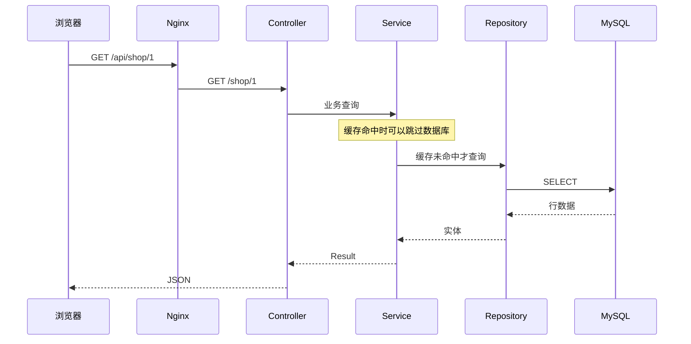
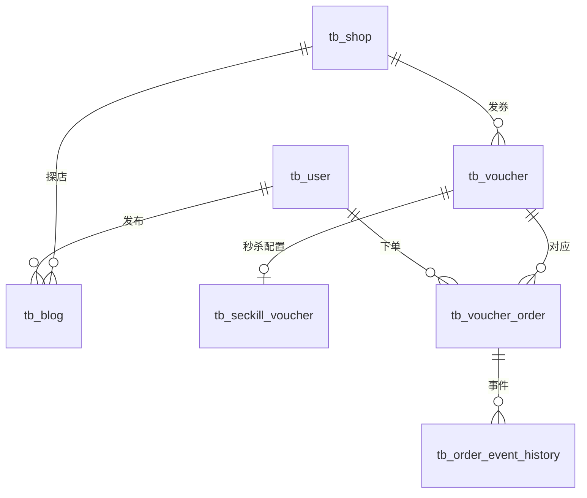

# 03 架构、代码与数据库

[返回目录](README.md) · [上一章](02-环境搭建与启动.md) · [下一章：登录与权限](04-登录权限与签到.md)

**本章学习目标**：本章教你沿一次请求读懂代码，并把实体、参数、Repository 里的 SQL 和事务对应起来。读完应能找到一个页面动作的三层实现，也能解释为什么需要唯一约束与受影响行数。

**本章导航**

- [1. 从一次请求看分层](#section-01)
- [2. 目录导航](#section-02)
- [3. 从一个字段追踪到数据库](#section-03)
  - [请求参数不是凭空进入 Java 的](#section-03-01)
  - [如何在 IDE 里跟一条链路](#section-03-02)
  - [DAO 的参数绑定怎么工作](#section-03-03)
  - [事务提交与返回失败有何关系](#section-03-04)
  - [数据库事务的边界图](#section-03-05)
  - [学会读一次更新的返回值](#section-03-06)
- [4. 实体、DTO 与快照有什么区别](#section-04)
- [5. 数据库的核心关系](#section-05)
- [6. 唯一约束如何帮助并发正确性](#section-06)
- [7. 迁移文件的阅读顺序](#section-07)
- [8. 响应、金额与时间约定](#section-08)
  - [用一个真实 Repository 方法读懂原生 SQL](#section-08-01)
- [9. 新增功能的规范示例](#section-09)
- [10. 手把手读懂分层、事务与数据库返回值](#section-10)
  - [先学会在三个位置读同一个名字](#section-10-01)
  - [更新了 0 行，不是只有“SQL 报错”一种解释](#section-10-02)
  - [事务像一次提交，不像所有组件共同签字](#section-10-03)
  - [Entity、DTO 和快照为什么不能随意互换](#section-10-04)
  - [用一个真实功能完成源码阅读作业](#section-10-05)

<a id="section-01"></a>

## 1. 从一次请求看分层

浏览器访问 `/api/shop/1`，Nginx 去掉 `/api`，转发给 Java 的 `/shop/1`。`ShopController` 接收路径参数 1，调用 `IShopService` 的实现；服务决定走缓存还是 Repository（数据访问层），最终将数据包装成 `Result` 返回 JSON。



**Controller** 管输入和输出，不直接拼数据库查询来完成复杂业务。**Service** 管业务规则、事务、权限归属、状态迁移和协调。**Repository/DAO** 管 SQL 和持久化操作。本项目使用 Spring Data JPA：每个 Repository 是一个接口，通常继承 `JpaRepository<实体, Long>`；简单查询用方法名派生（如 `findByEmail`），复杂 SQL 写在方法上的 `@Query(nativeQuery = true)` 里，由 Spring 在运行时生成实现。

学习顺序可以是 Controller → Service → Repository，开发新功能时则先明确表与 Repository，再实现 Service，最后提供 Controller。这条分层有自动检查：[ArchitectureTest](../src/test/java/com/hmdp/ArchitectureTest.java) 用 ArchUnit 规定只有 `repository` 包能使用 JdbcTemplate 或 `createNativeQuery`，Controller 不能依赖 Repository，Controller 的字段只能是 Service 接口。想绕过访问层直接写 SQL，测试会失败。

<a id="section-02"></a>

## 2. 目录导航

| 路径 | 内容 | 建议先读 |
| --- | --- | --- |
| [controller](../src/main/java/com/hmdp/controller) | 店铺、用户、笔记、券、订单、体验等接口 | `ShopController`、`VoucherOrderController` |
| [service](../src/main/java/com/hmdp/service) | 业务接口 | `IShopService`、`IExperienceService` |
| [service/impl](../src/main/java/com/hmdp/service/impl) | 业务实现与事务 | `ShopServiceImpl`、`VoucherOrderServiceImpl` |
| [repository](../src/main/java/com/hmdp/repository) | 数据访问：17 个 Spring Data 仓库与两个辅助类 | `VoucherOrderRepository`、`BusinessOutboxRepository`、`InsertRepository`、`Rows` |
| [entity](../src/main/java/com/hmdp/entity) | JPA 实体与只读的行模型 | `Shop`、`Voucher`、`VoucherOrder`、`BusinessOutboxTask` |
| [dto](../src/main/java/com/hmdp/dto) | 请求和返回模型 | `Result`、`UserDTO`、`LoginFormDTO`、`TokenPairDTO` |
| [security](../src/main/java/com/hmdp/security) | Spring Security 配置、JWT 签发与校验、验证码邮件 | `SecurityConfig`、`TokenService`、`UserContextFilter` |
| [cache](../src/main/java/com/hmdp/cache) | 请求缓存、CDC 消费与投影、读取采样 | `CacheChangeProjector`、`DebeziumCacheConsumer` |
| [messaging](../src/main/java/com/hmdp/messaging) | 业务事件与 Kafka 传输 | `BusinessEvent`、`KafkaBusinessTransport` |
| [analytics](../src/main/java/com/hmdp/analytics) | Kafka 行为事件传输与热榜入口 | `KafkaBehaviorTransport` |
| [reliability](../src/main/java/com/hmdp/reliability) | 限流、歧义 URI 拦截、管理操作审计、运维、维护任务 | `AccessGuard`、`OperationsController` |
| [utils](../src/main/java/com/hmdp/utils) | 缓存客户端、ID、当前用户等 | `CacheClient`、`RedisIdWorker`、`UserHolder` |
| [resources](../src/main/resources) | YAML、Lua、基础 SQL 和增量迁移 | `application.yaml`、`seckill.lua` |
| [frontend](../frontend) | 桌面静态页面、脚本、样式、证据 | `index.html`、`scripts/experience.js` |
| [dev](../dev) | Compose、Nginx、监控、Debezium 连接器配置、格式检查 | `docker-compose.yml` |
| [src/test/java](../src/test/java) | 单元测试、Testcontainers 集成测试、架构测试 | `ArchitectureTest`，其余按业务选择对应测试类 |

本项目的方法命名尽量写明“动作 + 业务对象”。`queryInventoryReconciliationReport` 表示生成库存对账报告，`markReservationFailedAndCompensateRedis` 表示保存预约失败状态后补偿 Redis，`syncReservationStateAndAcknowledgeMessage` 表示同步展示并确认消息。后一个动作不等于订单成功，状态仍可能是 FAILED 或 REVIEW。

批处理入口 `relayOutboxBatch` 和 `relayAnalyticsOutboxBatch` 明确一次只处理一批；访问采集 `submitShopVisitEvent` 返回事件号，用于后续追踪，不保证已落库。首次发布与人工恢复分别调用 `publishActivity(voucherId)`、`recoverActivity(voucherId)`，共享内部准备流程，避免在调用处猜测布尔参数的含义。

变量名称写明身份和单位，例如 `orderId`、`voucherId`、`eventId`、`ttlMillis`、`occurredAtMillis`。方法注释重点解释事务要求、重复执行、故障窗口与返回含义，避免把代码中的每条赋值再描述一遍。Java 方法名的调整不改变已有 HTTP 路径或 JSON 字段，例如 `/ops/seckill/{id}/reconcile` 仍调用同一个对账报告功能。

构造器注入可以清楚表示一个对象必须依赖哪些服务，已有代码也使用 `@Resource` 字段注入。不要因为某个类使用了构造器，就误以为它不符合风格；需要检查的是缩进、换行、导入、命名和职责，而不是统一禁止构造器。

<a id="section-03"></a>

## 3. 从一个字段追踪到数据库

<a id="section-03-01"></a>

### 请求参数不是凭空进入 Java 的

以 `/shop/1` 为例，`@GetMapping("/{id}")` 表示路径中有一个变量，`@PathVariable("id")` 把这个变量绑定到 Java 的 Long id。数字 1 是店铺 ID，不是店铺名称或分类 ID。

以 `/shop/search?typeId=1&minScore=45` 为例，参数进入 `ShopSearchDTO`，Service 校验范围后再用 JPA Specification 组合查询条件（包括球面距离表达式和“有可用优惠券”的 EXISTS 子查询），交给 `ShopRepository` 执行。Controller 不需要自己查询数据库才能知道参数合法；Service 更适合保存业务约束，便于其他调用入口复用。

<a id="section-03-02"></a>

### 如何在 IDE 里跟一条链路

1. 打开浏览器开发者工具的 Network，点击店铺，记录请求路径和响应。
2. 在 `ShopController.queryShopById` 放断点，确认传入 ID。
3. 进入 `ShopServiceImpl.queryShopDetail` 与 `queryById`，区分正常详情与纯缓存读。
4. 继续进入 CacheClient；已有缓存时可能看不到 SQL，这是正常的。
5. 在隔离环境的冷数据路径继续跟到 Repository，再查看数据库记录。
6. 返回时看 Result 与 JSON，判断实体中的哪些字段实际给了浏览器。

断点会暂停处理线程，可能让锁过期、消息重试或超时。所以用于理解代码的暂停不能当作正常延迟测量；也不要在共享秒杀任务上随意暂停很长时间。

<a id="section-03-03"></a>

### DAO 的参数绑定怎么工作

原生 SQL 里的 `:orderId` 是命名参数，由 Hibernate 绑定为 JDBC 参数，对应方法参数上的 `@Param("orderId")`。参数只能代表“值”，不能用作表名或排序表达式；这样不可信输入无论写什么，都不会改变 SQL 结构。复杂 SQL 集中写在各个 Repository 的 `@Query(nativeQuery = true)` 里，SQL 和方法签名在同一个文件中。

动态条件应先做白名单和类型检查。例如 search 的 sort 只允许 score、price、distance，经纬度必须是有限且在范围内的数，再由 Specification 组装条件，不能让浏览器自由决定一段 SQL。原来用字符串拼 `ORDER BY FIELD(id, ...)` 按给定 ID 顺序返回的地方，现在改为查出后在 Java 里按 ID 顺序排序，代码中已经没有拼接 SQL 的位置。

`:name` 与 `@Param` 写错一个字母，编译不会报错。[ArchitectureTest](../src/test/java/com/hmdp/ArchitectureTest.java) 会检查每条原生 SQL 里出现的 `:name` 集合与方法声明的 `@Param` 集合完全一致。

<a id="section-03-04"></a>

### 事务提交与返回失败有何关系

抛出符合回滚规则的异常通常触发 Spring 事务回滚；但 `return Result.fail(...)` 只是返回一个对象，并不天然通知数据库回滚。若一个方法已经写了一半数据再返回 fail，需要确认该路径是否显式回滚，或设计为校验全部通过后才开始写。

这也是阅读 Service 时不能只关注结尾 `Result.ok()` 的原因：先标出第一条写语句，再逐条看后续失败分支如何处理。当前核心履约在条件扣库存后出现错误会抛异常，让库存与订单写入一同回滚。

`TransactionTemplate.execute` 明确划出事务块；`@Transactional` 通常通过 Spring 代理生效。方法在同对象内直接调用另一个带注解方法，不应默认得到新的事务边界。具体行为要看代理调用、传播方式和当前是否已在事务中。

<a id="section-03-05"></a>

### 数据库事务的边界图

```text
同一事务可以覆盖：订单 INSERT + 库存 UPDATE + 预约更新 + Outbox INSERT
不自动覆盖：Redis DECR + 文件删除 + Kafka 网络发送
```

后一组要依靠幂等、补偿、提交后动作和持久任务协调，不能只给外层加一个注解就声称所有组件共同回滚。

<a id="section-03-06"></a>

### 学会读一次更新的返回值

SQL 执行没抛异常，与“改到了目标行”不同。条件不满足时影响 0 行，数据库可以正常返回；Service 必须解释是重复、状态已变、对象不存在还是未到期限。

同样，`INSERT IGNORE` 返回 0 不是自动成功，可能需要读现有记录核对业务身份。当前行为聚合会核对重复 eventId 的原有内容，秒杀会核对订单 ID 对应的用户与券。

<a id="section-04"></a>

## 4. 实体、DTO 与快照有什么区别

实体对应数据库中的行，例如 `VoucherOrder`，用 JPA 注解 `@Entity`/`@Table`/`@Id` 声明映射，不属于表列的字段标 `@Transient`。DTO 是接口边界传递的数据，例如 `LoginFormDTO` 表示邮箱和验证码，`UserDTO` 只暴露 id、昵称、头像这些公开资料（不含手机号、邮箱和密码）。它们不一定与数据库列一一对应。

快照表示“发生某个动作时的数据副本”。订单保存券标题、规则、实付金额、类型和店铺 ID 的快照，避免管理员修改券后，历史订单金额或归属跟着变化。缓存快照则是另一种用途：把对象序列化保存，读取时重新解码，避免一个请求修改共享实体污染其他请求。

内部消息任务使用 `BusinessOutboxTask`，秒杀预约使用 `SeckillReservation`，活动发布数据使用 `SeckillPublication`。Outbox、秒杀预约、Inbox、CDC 检查点、审计等可靠性表的读写全部是带条件的原生 SQL。Spring Data 要求每个 Repository 声明一个实体类型，所以这些表各有一个标了 `@Entity` 又同时标 `@Immutable` 的“锚点”类（`BusinessOutboxTask`、`SeckillReservation`、`BehaviorEventRecord`、`CacheCheckpoint`、`MediaOwner`、`MessageInboxEntry`、`OperationAudit`），它们只用作仓库的领域类型，其中后五个只声明了主键字段。查询返回一行 `Map`；需要成形对象时，由 `BusinessOutboxTask.fromRow`、`SeckillReservation.fromRow`、`SeckillPublication.fromRow` 这类方法把 `order_id` 等列明确转成 `orderId` 等 Java 属性。这些对象从不作为受管实体加载，所以 JPA 的脏检查不会在事务提交时把内存里的改动悄悄写回。

转换时借助 [Rows](../src/main/java/com/hmdp/repository/Rows.java)：Hibernate 原生查询按 JDBC 默认类型返回值，TINYINT 是 `Byte`、DATETIME 是 `Timestamp`、`SUM` 是 `BigDecimal`，直接强转成 `Integer`/`Long` 会抛 ClassCastException。Service 拿到的是转换好的对象，可以直接调用 getter。接口已有的 JSON 字段保持原约定，内部模型不等于对外响应格式。

`OrderStatus` 和 `VoucherType` 给数据库数字提供业务名称。例如 `OrderStatus.UNPAID.getCode()` 仍写入数字 1，但读代码时可以立即知道含义。`OutboxState`、`ReservationState` 给字符串状态提供统一名称。枚举不会自动代替 SQL 的状态条件或行锁；并发保护仍由 Repository 的条件 SQL 与事务共同完成。

`Result<T>` 的 `T` 表示 data 的 Java 类型，例如 `Result<SeckillReservation>`。这样内部调用拿到预约时无需从 Object 强制转换。它的 JSON 外层依然是 success、errorMsg、data 和 total，现有页面可以按原字段读取。

Java 的 `final Map` 只是不允许把变量重新指向另一张 Map，并不意味着 Map 内容不可修改。因此缓存安全不能只靠 `final` 关键字判断。

<a id="section-05"></a>

## 5. 数据库的核心关系



这是业务关系示意图，不表示每个关系都声明了数据库外键。项目通过业务校验、索引、事务与唯一约束维护相关规则。

理解数据库时，把表分为四组：

1. **业务表**：用户、店铺、笔记、券、订单。
2. **关系与资源表**：关注边、点赞、图片归属、笔记图片引用。
3. **可靠性表**：秒杀预约、死信、Outbox、Inbox、操作审计、CDC 检查点。
4. **分析表**：行为事件、分钟热度桶、登录访问用户、分析 Outbox 与失败记录。

数据库并不是“只为了订单”。它还保存消息进度和可恢复的关系事实，使服务退出之后不会只剩内存中的未完成任务。

<a id="section-06"></a>

## 6. 唯一约束如何帮助并发正确性

- 用户邮箱唯一（V10 的 `uk_user_email`）：同一邮箱同时首次登录的两个请求不能注册出两个账号；输掉竞争的一方插入时收到唯一键异常，回查已存在的用户继续登录。
- `tb_ordinary_order_slot(user_id,voucher_id)` 主键：为普通券同一用户提供稳定可加行锁的槽位，避免查询“还没有订单”时并发穿透。
- 秒杀预约唯一键使用 `voucher_id,active_user`。FAILED 预约的生成列为 NULL，使明确失败后可以释放资格；PROCESSING、SUCCESS、REVIEW 仍占资格。
- `tb_message_inbox(consumer_group,event_id)` 主键：同一逻辑组不能重复完成同一数据库处理步骤。
- `tb_behavior_event(event_id)` 主键：同一行为事件只统计一次。
- 关注边、点赞、笔记图片引用也有各自唯一约束。

分布式锁帮助减小竞争范围，但锁的租约可能到期、连接可能断开；最终数据库约束仍要兜底。出现唯一键冲突时，需要区分“重复同一业务”与“相同 ID 对应不同业务身份”，后者不能直接当成功。

在 Spring Data JPA 下，唯一键冲突抛出的是 `DataIntegrityViolationException`（迁移前的历史版本用 MyBatis-Plus，抛的是 `DuplicateKeyException`）。要让这个异常在“插入那一行代码”抛出，而不是拖到事务提交时才冒出来，项目的插入走 `InsertRepository.insert()`：它执行 `persist` 后立即 `flush`。原因见 [8. 用一个真实 Repository 方法读懂原生 SQL](#section-08-01) 中的 save 与 merge 陷阱。

<a id="section-07"></a>

## 7. 迁移文件的阅读顺序

| 版本 | 主要变化 |
| --- | --- |
| V1 | 订单快照、秒杀预约与活动、死信、业务 Outbox、持久关注/点赞、图片归属、审计和索引、普通券槽位 |
| V2 | 笔记正文扩为 TEXT |
| V3 | 秒杀活动增加已发布标记，防止用过的活动被随意重置 |
| V4 | 图片生命周期与笔记图片引用、删除事件资源路径 |
| V5 | CDC 检查点记录 |
| V6 | Outbox 租约/发送/消费时间、Inbox、消息失败、订单事件历史、订单到期时间 |
| V7 | 秒杀持久交接幂等键 |
| V8 | 行为 Outbox、事件事实、分钟桶、登录用户去重、消费失败及订单店铺快照 |
| V9 | 分析事件发送检查点 |
| V10 | 邮箱登录：`tb_user` 改为 `ROW_FORMAT=DYNAMIC`（课程表是 COMPACT，767 字节的索引上限放不下 254 个 utf8mb4 字符的邮箱），新增 `email VARCHAR(254)` 与唯一键 `uk_user_email`，`phone` 改为可空，给已有用户补 `user<id>@example.com` |
| V11 | 惊喜袋取货时间窗：`tb_seckill_voucher` 新增可空的 `pickup_begin_time` / `pickup_end_time`；`tb_shop.x/y` 改为有符号（西经为负） |

详见 [迁移目录](../src/main/resources/db/migration)。不要只读原始 `hmdp.sql` 就认为已经掌握当前数据库；扩展设计主要在这些迁移中。表结构只由 Flyway 管理，配置里 `spring.jpa.hibernate.ddl-auto=none`，Hibernate 不会根据实体自动建表或改表；`open-in-view=false` 让数据库会话不延续到视图渲染阶段。

<a id="section-08"></a>

## 8. 响应、金额与时间约定

统一业务响应见 [Result](../src/main/java/com/hmdp/dto/Result.java)：`success`、`errorMsg`、`data`、`total`。`total` 并非所有分页接口都会填充，课程型列表可能只返回当前页数组；按接口实际返回解析。

订单与券的 `payValue`、`actualValue`、`payValueSnapshot` 用**分**；店铺平均价格筛选 `maxPrice` 用**元**；评分 `minScore=45` 表示 4.5 分。不要把金额字段混用。

订单 ID 是 Java Long，可能超过 JavaScript 安全整数范围。浏览器应保留为字符串，不能先 `Number(id)` 再转字符串；精度已经丢失就无法恢复。

业务时间涉及 Java `LocalDateTime`、MySQL 时间、Redis TIME 与消息时间戳。容器时区和宿主机时区可能不同；演示活动时按服务实际解释的时间设置。日志当前只显示分秒毫秒，不是完整日期时间，排查时还要结合 Docker 日志时间和事件表。

<a id="section-08-01"></a>

### 用一个真实 Repository 方法读懂原生 SQL

[VoucherOrderRepository](../src/main/java/com/hmdp/repository/VoucherOrderRepository.java) 声明：

```java
@Transactional
@Modifying(flushAutomatically = true, clearAutomatically = true)
@Query(
    value =
        """
        UPDATE tb_voucher_order
        SET status=4
        WHERE id=:orderId AND status=1 AND expire_at<=NOW(3)
        """,
    nativeQuery = true)
int closeExpiredOrder(@Param("orderId") Long orderId);
```

逐个注解读：

- `@Query(nativeQuery = true)`：`value` 文本块里是原样发给 MySQL 的 SQL，不是 JPQL。项目把迁移前全部 115 条 Mapper XML 语句原样搬进了这种注解，`FOR UPDATE`、`SKIP LOCKED`、`INSERT IGNORE`、条件 UPDATE 返回影响行数的语义都没有变，只是参数写法从 `#{orderId}` 变成 `:orderId`。
- `@Param("orderId")`：把方法参数绑定到 SQL 中的 `:orderId`。
- `@Modifying`：告诉 Spring Data 这是写语句，返回值 `int` 就是数据库报告的影响行数。`flushAutomatically = true` 表示执行前先把持久化上下文里尚未写出的改动刷到数据库；`clearAutomatically = true` 表示执行后清空持久化上下文。原生 UPDATE 直接改表、绕过了 JPA 的一级缓存，如果不清空，同一事务里随后 `findById` 可能拿到内存中的旧对象。
- `@Transactional`：JPA 要求原生写语句必须在事务中执行（MyBatis 没有这个要求）。若调用方已经开了事务（例如 `TransactionTemplate`），这里会加入外层事务，而不是另起一个。

简单查询不需要写 SQL。同一个接口里的 `findByUserIdAndStatus(Long userId, Integer status, Pageable pageable)` 由 Spring Data 按方法名生成查询；分页用 `Pageable`，注意 Spring 的页码从 0 开始，而接口参数 `current` 从 1 开始，Service 里会写成 `current - 1`。`JpaRepository` 自带的 `findById`、`findAll` 等基础方法同样经过 Repository 访问数据库。不要把“看不到 SQL”误认为“没有 DAO 层”。

**save 与 merge 的陷阱**。Spring Data 的 `save()` 看到实体已经带 ID，就当作“可能已存在的记录”执行 merge：先按 ID 查一次，库里已有同 ID 的行就改发 UPDATE。本该被主键挡住的重复插入，就这样悄悄变成了更新。订单 ID 由 `RedisIdWorker` 预先生成，正好属于这种情况，用 `save()` 会让重复订单覆盖原订单而不报错。所以项目的仓库都继承 [InsertRepository](../src/main/java/com/hmdp/repository/InsertRepository.java)，由片段实现 [InsertRepositoryImpl](../src/main/java/com/hmdp/repository/InsertRepositoryImpl.java) 提供：

- `insert()`：永远执行 `persist` 并立即 `flush`，即永远发出 INSERT；重复键当场抛 `DataIntegrityViolationException`。
- `updateById()`：只把补丁对象中的非空字段拷贝到库中同 ID 的记录，对应 MyBatis-Plus 时代同名方法的行为。

实体还标了 Hibernate 的 `@DynamicInsert`/`@DynamicUpdate`：INSERT 只包含非空列，`create_time` 这类列照常使用数据库默认值。

**原生 SQL 由谁把关**。Hibernate 启动时不会校验原生 SQL，写错一个列名要等到线上执行那条路径才报错。[NativeQuerySmokeIntegrationTest](../src/test/java/com/hmdp/repository/NativeQuerySmokeIntegrationTest.java) 因此在 Testcontainers 启动的真实 MySQL 上把 `repository` 包里全部 119 条原生查询各执行一次（写语句放在回滚的事务里），任何一条语法或列名错误都会让测试失败；参数名的一致性由前面提到的 `ArchitectureTest` 检查。

<a id="section-09"></a>

## 9. 新增功能的规范示例

以“查询本人订单事件”为例：先在 Repository 写按用户和订单归属查询的方法（简单条件用派生方法名，复杂条件写原生 `@Query` 并配好 `@Param`）；Service 从 `UserHolder` 获取当前用户并校验归属（`UserHolder` 由 Spring Security 链中的 `UserContextFilter` 根据 JWT 填入，请求结束时清理）；Controller 接收路径参数并调用 Service 接口，不直接注入 Repository。前端不传一个 `userId` 就决定自己能看谁的订单。

Java 使用明确 import，避免 `org.xxx.SomeType` 在字段或参数里长串堆叠；遵循 Google Java Style 的缩进与换行，不使用通配符 import。项目提供 [检查脚本](../dev/java-style.sh)：

项目额外要求 `@Resource` 独立成行，字段声明写在下一行。格式化脚本会保留这一约定，Checkstyle 会阻止重新写回同一行：

```java
@Resource
private IBlogService blogService;
```

```bash
sh dev/java-style.sh check
# 主动整理代码时使用 format；会改动 Java 源文件
sh dev/java-style.sh format
```

格式检查帮助统一外观，业务分层和命名仍要靠设计与审查。不要把 Checkstyle 通过当作业务正确性证明。

<a id="section-10"></a>

## 10. 手把手读懂分层、事务与数据库返回值

<a id="section-10-01"></a>

### 先学会在三个位置读同一个名字

从 [VoucherOrderRepository](../src/main/java/com/hmdp/repository/VoucherOrderRepository.java) 的 `closeExpiredOrder` 开始，在方法签名看输入和返回类型，在它上方的 `@Query` 看更新条件，再到 [OrderLifecycleServiceImpl](../src/main/java/com/hmdp/service/impl/OrderLifecycleServiceImpl.java) 看谁调用、何时调用。

方法签名告诉你输入是 orderId，返回值是更新行数；SQL 告诉你仅更新状态为待支付（`status=1`）且已经到期（`expire_at<=NOW(3)`）的订单；Service 告诉你调用前还有行锁、券类型和截止时间检查，成功后才登记关闭事件。三者结合才是完整行为。

“DAO 先写、Service 再组合、Controller 最后调用”的目的，是把数据库操作、业务判断和 HTTP 参数拆开。Controller 不应该为了展示进度临时执行 SQL，Service 也不需要直接操作 JDBC 连接。`JpaRepository` 基础方法、派生查询和手写的原生 `@Query` 都属于项目的数据访问路径。

<a id="section-10-02"></a>

### 更新了 0 行，不是只有“SQL 报错”一种解释

假设订单 9001 原来待支付，两个线程分别执行支付与到期关闭。关闭 SQL 带着 `status=1` 条件。如果支付已经提交，关闭更新 0 行，说明它没有取得这次状态迁移，而不是必须重试直到成功。

同样，`INSERT IGNORE` 返回 0 可能表示唯一键已存在。行为事件消费不能只把这个 0 当成功：还要比较原记录的店铺、用户、动作和时间是否与新事件一致。同 ID 同内容是合法重放，同 ID 不同内容是身份冲突。阅读 SQL 返回值时，始终先列出“0 可能来自哪些情况”。

| 返回值/结果 | 应先考虑的含义 | 上层还要做什么 |
| --- | --- | --- |
| 条件 UPDATE 返回 1 | 当前记录满足条件并完成迁移 | 登记与这次迁移一致的事件 |
| 条件 UPDATE 返回 0 | 不存在，或当前状态/时间已不符合 | 结合前置查询和业务契约决定是否返回原结果 |
| 去重 INSERT 返回 0 | 主键或唯一约束阻止了新插入 | 必要时比较业务身份，不能吞掉内容冲突 |
| 查询返回空集合 | 当前条件下没有记录 | 区分不存在、尚未落地和无权限的接口表现 |

<a id="section-10-03"></a>

### 事务像一次提交，不像所有组件共同签字

数据库事务会让本连接中的一组写入共同提交或回滚。订单与同库 Outbox 一起写入，可以避免“订单提交了却没有待发送任务”。Redis 失效、MQ 发送和文件删除不因此成为同一个数据库事务。

例如先删除文件再回滚数据库，SQL 回滚不会把文件恢复；Kafka 发送也一样，项目因此先把事件写进同库 Outbox，由 Relay 在事务提交后发送。项目为此使用资源状态与异步删除任务，使失败后仍有可追踪的处理责任。理解事务时，把每一步标出执行介质，再用框圈出真正同事务的数据库操作。框外步骤都要另找重试、幂等或补偿。

Spring 的声明式事务还经过代理；在同一个对象内部直接调用自己的另一个方法，不能只因被调方法有 `@Transactional` 就假定又建立了所需事务。项目不少可靠性流程直接使用 `TransactionTemplate` 明确包住临界数据库操作。阅读时要跟到实际入口，而不是只搜索注解个数。

另外，返回 `Result.fail` 是普通返回值，本身不会触发事务回滚。若此前已经执行数据库修改，必须检查是否抛异常、标记回滚或在修改前完成校验。不能把“页面显示失败”当成“数据库一定没写”。

<a id="section-10-04"></a>

### Entity、DTO 和快照为什么不能随意互换

Entity 表达数据库记录，DTO 表达接口需要交换的字段，快照保存一个历史时点。以订单为例，当前券可能改价格或迁店，订单金额按领取时保存的快照解释；分析事件使用历史店铺快照。当前本人订单详情中的补充 shopId 仍取当前券的归属，不能把这个字段宣传为已经完全按历史快照展示。

`BusinessOutboxTask` 是 Repository 读取任务的类型模型。`aggregateId` 指向这条事件关联的业务对象，未必是订单：店铺失效事件可以指店铺，社区事件可以指笔记；它同时是 Kafka 消息的 key，保证同一对象的事件在同一分区内有序。字段用了 Long 不表示不同对象的 ID 可以互换；还要结合 kind 判断。`fromRow` 显式把 `aggregate_id` 列转成 `aggregateId`，有助于避免依赖隐含命名猜测。

内部使用枚举改善语义，并不意味着接口可随意改返回值。订单状态仍要保持已有数字协议，预约和消息任务使用各自状态名称。重构内部名字时，检查序列化、SQL 和 Lua 的外部约定，不能只改 Java 编译能通过的引用。

<a id="section-10-05"></a>

### 用一个真实功能完成源码阅读作业

选择“关闭过期普通订单”，依次完成：

1. 在 [OrderLifecycleServiceImpl](../src/main/java/com/hmdp/service/impl/OrderLifecycleServiceImpl.java) 找到 `expireOverdueOrders`，它调用 `VoucherOrderRepository.selectExpiredOrdinaryOrders()` 读取候选订单 ID（每次最多 200 条）。解释候选查询为什么不是最终判断：读出 ID 与真正关闭之间，用户可能已经付款。
2. 找到单订单事务 `closeExpiredOrdinaryOrder`：它用 `TransactionTemplate` 包住整个过程，先调 `selectExpiryStateForUpdate`（`... FOR UPDATE` 锁住这一行，并读出状态、券类型快照、截止时间和是否到期），再调带条件的 `closeExpiredOrder`。
3. 说明另一个线程先支付后，该关闭流程走哪一个分支：锁住后读到的状态已不是待支付，直接返回 false；即使跳过这次检查，`closeExpiredOrder` 的 `status=1` 条件也会让更新返回 0。另外留意“尚未到期”（`due` 为 0）时它只重新登记截止事件，不关单。
4. 找到关闭事件写入 `registerOrderClosedEvent`，判断它与订单更新是否同事务：它先用 `requireTransaction()` 确认当前确实处在事务中，再把 `ORDER_CLOSED` 写进 Outbox。
5. 到 [OutboxRelayServiceImpl](../src/main/java/com/hmdp/service/impl/OutboxRelayServiceImpl.java) 的 `relayOutboxBatch` 找下一段执行，说明它与上一步为何不是一个事务：Kafka 发送是网络调用，必须等订单事务提交后再由 Relay 认领并发送。

作业完成标准不是记住方法名，而是能在源码中指出“候选过期”和“真正关闭”之间还有重新校验。类似方法名的差异往往对应不同保证，忽略它就容易把扫描任务写成无条件修改状态。
