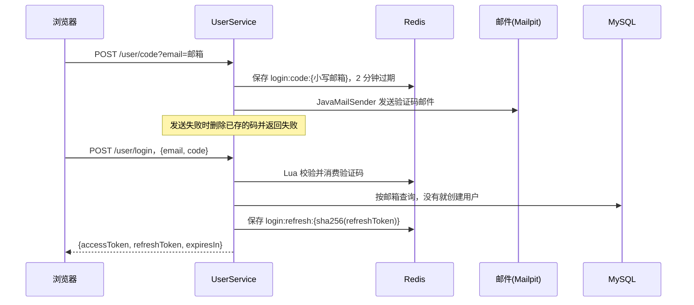

# 04 登录、权限与签到

[返回目录](README.md) · [上一章](03-架构代码与数据库.md) · [下一章：四层缓存](05-五层缓存与一致性.md)

**本章学习目标**：先理解为什么 Session 方案要改成共享登录，再看它为什么最终走到“邮箱一次性验证码 + JWT + Spring Security”。分段读验证码、签发令牌、刷新轮换、登出吊销和请求过滤链。最后用具体二进制数字解释连续签到。读完应能自己画出认证顺序，说清 access token 与 refresh token 各管什么，并指出身份什么时候被清理。

> 迁移说明：课程与本项目早期版本使用“手机号 + 短信验证码（实际只打日志）+ Redis 随机 token + 拦截器”。`na-stack-migration` 分支已改为邮箱验证码、JWT 和 Spring Security，旧的 `RefreshTokenInterceptor`、`LoginInterceptor` 已删除。本章按当前代码讲解，涉及旧设计的地方会明确标出。

**本章导航**

- [1. 为什么把 Session 换成共享登录，再换成 JWT](#section-01)
- [2. 发送验证码到登录成功](#section-02)
- [3. 当前 TTL 要读配置，不能照搬课程](#section-03)
- [4. 实际生效的过滤链与 AccessGuard](#section-04)
- [5. ThreadLocal 怎么理解](#section-05)
- [6. 从 Session 推导当前登录实现](#section-06)
  - [先实现一台服务器上的最小登录](#section-06-01)
  - [为什么验证码 Key 不能都叫 code](#section-06-02)
  - [第一步：阅读发送验证码](#section-06-03)
  - [第二步：为什么验证码校验与删除不能分两次](#section-06-04)
  - [第三步：阅读登录成功后的签发过程](#section-06-05)
  - [第四步：请求如何恢复用户](#section-06-06)
  - [用两个请求演算 ThreadLocal](#section-06-07)
  - [第五步：refresh token 为什么只存哈希、每次轮换](#section-06-08)
  - [第六步：无状态 JWT 为什么还需要登出黑名单](#section-06-09)
- [7. 哪些接口可以匿名访问](#section-07)
  - [管理员身份为什么每次请求计算](#section-07-01)
  - [监控凭证只能读指标](#section-07-02)
  - [已修复的路径规范化绕过](#section-07-03)
- [8. 限流怎么保护入口](#section-08)
- [9. Bitmap 签到](#section-09)
- [10. 从日历格子推导连续签到算法](#section-10)
  - [签到次数与连续签到不同](#section-10-01)
  - [写入当前日的代码](#section-10-02)
  - [读取位串并逐位计算](#section-10-03)
  - [独立练习，不改业务签到数据](#section-10-04)
- [11. 亲手验证](#section-11)
- [12. 把登录、鉴权与签到按一次真实请求讲清楚](#section-12)
  - [用户身份经过了哪些位置](#section-12-01)
  - [用户 JWT 与监控 Bearer 凭证怎样区分](#section-12-02)
  - [验证码为何要原子消费，而不是先比较再删除](#section-12-03)
  - [TTL 的数字要连同单位一起看](#section-12-04)
  - [ThreadLocal 只能保存当前线程的请求上下文](#section-12-05)
  - [签到练习要算出具体答案](#section-12-06)

<a id="section-01"></a>

## 1. 为什么把 Session 换成共享登录，再换成 JWT

传统 Session 常由单台应用服务器保存。登录请求到了 A，下一次业务请求到了 B，B 可能找不到 A 的会话。课程的解法是把登录状态放进共享 Redis：登录生成随机 token，Redis 用 token 对应一份用户简要信息，每次请求都去 Redis 查一次。这是本项目迁移前的做法。

当前方案改为 **JWT（JSON Web Token）**：登录成功后，服务端用只有自己知道的密钥对一组声明（用户 ID、昵称、头像、过期时间等）做 HS256 签名，得到 access token。浏览器每次请求带 `Authorization: Bearer <accessToken>`，服务端只需验签和检查过期时间，就能确认身份，不必为每个请求查 Redis 取用户。任何实例只要拿到同一把密钥都能验证，这同样解决了多实例共享登录的问题。

无状态也带来新问题，这正是本章后半部分的重点：

| 问题 | 原因 | 当前做法 |
| --- | --- | --- |
| token 泄漏后无法“删掉” | 签名有效就能用，服务端没有会话可删 | access token 只有 15 分钟；登出时把它的 `jti` 写入 Redis 黑名单 |
| 15 分钟太短，用户要频繁登录 | 短寿命是为了限制泄漏窗口 | 另发一个 7 天的 refresh token，用来换新的 access token |
| refresh token 本身更值钱 | 寿命长 | Redis 只存它的 SHA-256；每次使用都轮换，旧值立即作废 |
| 管理员被撤销后旧 token 还写着“管理员” | 如果把角色写进 token | 角色不进 token，每次请求按配置计算 |

验证、授权与 401/403 响应交给 **Spring Security 6 资源服务器**（Nimbus 实现的 JWT 编解码），而不是手写拦截器。

<a id="section-02"></a>

## 2. 发送验证码到登录成功



代码入口：[UserController](../src/main/java/com/hmdp/controller/UserController.java)、[UserServiceImpl](../src/main/java/com/hmdp/service/impl/UserServiceImpl.java)、[TokenService](../src/main/java/com/hmdp/security/TokenService.java)、[LoginCodeSender](../src/main/java/com/hmdp/security/LoginCodeSender.java)、[SecurityConfig](../src/main/java/com/hmdp/security/SecurityConfig.java)、[验证码 Lua](../src/main/resources/consume-code.lua)。

四个接口：

| 接口 | 请求 | 作用 |
| --- | --- | --- |
| `POST /user/code?email=...` | 无需登录 | 生成 6 位数字码并发邮件；同一邮箱一分钟一次 |
| `POST /user/login` | body `{email, code}` | 一次性消费验证码；首次登录自动注册；返回令牌对 |
| `POST /user/refresh` | body `{refreshToken}` | 轮换：返回新令牌对，旧 refresh token 立即失效 |
| `POST /user/logout` | 需要 Bearer；body 可选 `{refreshToken}` | 删除 refresh token，并吊销当前 access token |

验证码消费采用原子校验和删除，防止两个并发请求都用同一验证码登录成功。邮箱先统一 `trim` 并转小写，`tb_user.email` 有唯一键 `uk_user_email` 兜底并发注册：插入发生唯一键冲突（`DataIntegrityViolationException`）时，再按邮箱查询已创建的用户。access token 与返回给浏览器的用户 DTO 只含 `id`、`nickName`、`icon`，不含邮箱、手机号等个人信息。

<a id="section-03"></a>

## 3. 当前 TTL 要读配置，不能照搬课程

| 对象 | 当前寿命 | 来源 |
| --- | --- | --- |
| 登录验证码 `login:code:{email}` | 2 分钟 | [RedisConstants](../src/main/java/com/hmdp/utils/RedisConstants.java) 的 `LOGIN_CODE_TTL` |
| access token（JWT） | 默认 15 分钟 | `hmdp.security.access-token-ttl`，环境变量 `HMDP_ACCESS_TOKEN_TTL` |
| refresh token `login:refresh:{sha256}` | 默认 7 天 | `hmdp.security.refresh-token-ttl`，环境变量 `HMDP_REFRESH_TOKEN_TTL` |
| 吊销记录 `login:revoked:{jti}` | 该 access token 剩余的寿命 | 登出时计算 |

登录返回的 `expiresIn` 是 access token 寿命，单位是**秒**（默认 900）。

与迁移前不同，这里**没有滑动过期**：access token 签发后寿命固定，请求不会延长它；“保持登录”靠前端在收到 401 后用 refresh token 换一对新令牌。迁移前的 Redis token 方案是 25 天并在每次请求时续期，那是旧设计，不要再拿来描述当前系统。

签名密钥是 `hmdp.security.jwt-secret`（环境变量 `HMDP_JWT_SECRET`），HS256 要求至少 32 字节，不足时应用启动直接失败。仓库里的默认值只为本地克隆即可运行；任何共享或部署环境都必须自己设置。

<a id="section-04"></a>

## 4. 实际生效的过滤链与 AccessGuard

认证和授权现在发生在 Spring Security 过滤链里，早于 Spring MVC。一个请求依次经过：

1. Security 防火墙（StrictHttpFirewall）：拒绝含 `;` 参数、编码斜杠、`..` 段等歧义路径，返回 400。
2. [MonitorTokenFilter](../src/main/java/com/hmdp/security/MonitorTokenFilter.java)：只识别 Prometheus 静态凭证，见 [7.2](#section-07-02)。
3. `BearerTokenAuthenticationFilter`（Spring 自带）：取 `Authorization: Bearer ...`，用 `JwtDecoder` 验签、校验 `iss=hmdp`、过期时间以及是否在吊销名单中。
4. [UserContextFilter](../src/main/java/com/hmdp/security/UserContextFilter.java)：把认证通过的 JWT 转成 `UserDTO` 放进 `UserHolder`，请求结束清理。
5. `authorizeHttpRequests` 路由规则：匿名、登录、ADMIN、MONITOR 各自能访问什么，见第 7 节。
6. Spring MVC 拦截器 [AccessGuard](../src/main/java/com/hmdp/reliability/AccessGuard.java)（由 [MvcConfig](../src/main/java/com/hmdp/config/MvcConfig.java) 注册）：只负责限流、再次拒绝歧义 URI、记录管理操作审计。它不再判断“是否登录”或“是否管理员”。

业务请求头写法：

```http
Authorization: Bearer <登录返回的 accessToken>
```

这是标准的 Bearer 格式。迁移前业务 token 不带 `Bearer ` 前缀、只有监控凭证带前缀；现在两者格式相同，由服务端区分（见 [12.2](#section-12-02)）。没有 token 或 token 无效时，返回 HTTP 401 和 `{"success":false,"errorMsg":"请先登录"}`；已登录但权限不足返回 403 和“当前账号没有管理权限”。

注意：请求一旦**携带**了 Bearer token，过滤器就会尝试验证它；token 过期、被吊销或伪造时，即使访问的是公开路径也会得到 401。前端 [api.js](../frontend/scripts/api.js) 遇到 401 会先用 refresh token 静默续期一次再重试（并发的多个 401 共享同一次续期，因为 refresh token 只能用一次），续期失败才回到登录页。

<a id="section-05"></a>

## 5. ThreadLocal 怎么理解

`UserHolder` 使用 ThreadLocal，让一个请求的服务代码可以取得当前用户，不用每层都额外传 userId。它绑定的是当前处理线程，不是为每个用户永久分配一条线程。迁移到 Spring Security 后，业务代码仍然通过 `UserHolder.getUser()` 取用户，所以 Service 层基本不用改。

Web 服务器会复用线程。如果请求结束不清理，上一个用户的信息可能影响下一个请求。因此 `UserContextFilter` 在 `finally` 里调用 `UserHolder.removeUser()`。后台异步任务不能假定还能读到请求线程的用户；应从持久任务中明确携带并校验身份信息。

注销会吊销**当前**这一对令牌（当前 access token 的 jti，加上请求体里给出的 refresh token）。它不会自动踢掉这个用户在其他设备上的令牌。

<a id="section-06"></a>

## 6. 从 Session 推导当前登录实现

<a id="section-06-01"></a>

### 先实现一台服务器上的最小登录

教学上可以先设想：验证码写在 HttpSession，验证成功后把用户保存在同一 Session，再由 Cookie 带会话 ID。这样单机能工作，但换一台应用实例后，如果会话不共享，用户会突然变成未登录。

当前项目已经完全不用 HttpSession：`SecurityConfig` 把会话策略设为 `STATELESS`，同时关闭了表单登录、HTTP Basic、默认 logout 和 CSRF（没有 Cookie 会话，CSRF 防护的前提不存在）。验证码放在 Redis，身份放在 JWT 里，任何实例都能处理任何请求。

<a id="section-06-02"></a>

### 为什么验证码 Key 不能都叫 code

Redis 被所有用户共享。如果每次都 `SET code 验证码`，B 获取验证码会覆盖 A 的验证码。Key 应包含验证码对应的邮箱：`login:code:{小写邮箱}`。Key 标识一份数据的归属，value 保存验证码，TTL 限定可使用时间。邮箱先统一小写，否则 `A@x.com` 与 `a@x.com` 会得到两份验证码、注册出两个账户。

这不意味着浏览器应该用邮箱当登录凭证。邮箱可被别人知道，无法证明持有人身份；完成验证码校验后需要签发不可伪造的令牌。

<a id="section-06-03"></a>

### 第一步：阅读发送验证码

以下为 [UserServiceImpl.java](../src/main/java/com/hmdp/service/impl/UserServiceImpl.java) 的相关源码片段。为便于阅读只展示当前部分，依赖与 import 请查看原文件；无需把片段另建类复制运行。

```java
public Result sendCode(String rawEmail) {
  String email = normalizeEmail(rawEmail);
  if (email == null || email.length() > 254 || RegexUtils.isEmailInvalid(email)) {
    return Result.fail("邮箱格式错误！");
  }
  if (!rateLimiter.allow("code-email:" + email, 1, 60000)) {
    return Result.fail("请一分钟后再获取验证码");
  }
  String code = RandomCodes.digits(6);
  stringRedisTemplate
      .opsForValue()
      .set(LOGIN_CODE_KEY + email, code, LOGIN_CODE_TTL, TimeUnit.MINUTES);
  if (!loginCodeSender.send(email, code)) {
    stringRedisTemplate.delete(LOGIN_CODE_KEY + email);
    return Result.fail("验证码发送服务未配置");
  }
  return Result.ok();
}
```

| 代码步骤 | 为什么需要 | 缺少时可能怎样 |
| --- | --- | --- |
| 规范化 + 格式与长度校验 | 尽早拒绝无效邮箱；254 字符与数据库列一致 | 生成无意义验证码与状态 |
| 每邮箱窗口限制 | 防止反复覆盖验证码、刷邮件 | 一分钟产生大量验证码与邮件 |
| `RandomCodes.digits(6)` | 用 `SecureRandom` 生成六位码 | 可预测的随机数让验证码可被猜 |
| Redis SET + TTL | 跨实例读取且自动失效 | 永久可用或依赖单机 Session |
| 发送失败就删码 | **fail closed**：投递不了就不留下可用的码 | 用户收不到码，码却仍然有效 |

[LoginCodeSender](../src/main/java/com/hmdp/security/LoginCodeSender.java) 决定怎样投递：

- `hmdp.mail.enabled=true` 且有可用的 `JavaMailSender`（SMTP 由 `SPRING_MAIL_HOST/PORT` 配置）时发邮件。本地 Compose 发到 Mailpit，打开 http://127.0.0.1:8025 查看。
- 没有 SMTP 时默认**失败**：请求返回“验证码发送服务未配置”，并删除刚存的码。
- 只有显式设置 `hmdp.mail.log-codes=true`（环境变量 `HMDP_LOGIN_CODE_LOG`）才把验证码写进日志，而且日志里的邮箱会打码（如 `u***@example.com`）。这个开关只用于隔离的演示机：`deploy/compose.yml` 面向的小机器没有 SMTP，所以那里明确打开了它并写了说明。

为什么默认不写日志？验证码等于一次登录权限。日志常被集中收集、长期保留、给更多人看；“验证码默认打印到日志”意味着能读日志的人就能登录任意账户。迁移前的课程代码正是用 `log.debug` 打印验证码来模拟短信，这在演示里方便，在任何共享环境里都是漏洞。

<a id="section-06-04"></a>

### 第二步：为什么验证码校验与删除不能分两次

设想两个登录请求都 GET 到相同验证码，它们各自比较成功，再各自 DEL。两个请求都可能登录成功，同一次验证被消费了两遍。当前使用 Lua 把比较与消费放到一次 Redis 执行中。

以下为 [consume-code.lua](../src/main/resources/consume-code.lua) 的相关源码片段。为便于阅读只展示当前部分，依赖与 import 请查看原文件；无需把片段另建类复制运行。

```lua
if redis.call('GET',KEYS[1])~=ARGV[1] then return 0 end
redis.call('DEL',KEYS[1])
return 1
```

这里 KEYS[1] 是带邮箱的验证码 Key，ARGV[1] 是本次输入。只有匹配才删除并返回成功；删除后第二个请求读不到原值。验证码验证成功后数据库操作如果失败，验证码也不会由 MySQL 回滚恢复，这体现了组件事务边界。

<a id="section-06-05"></a>

### 第三步：阅读登录成功后的签发过程

以下为 [UserServiceImpl.java](../src/main/java/com/hmdp/service/impl/UserServiceImpl.java) 的相关源码片段。为便于阅读只展示当前部分，依赖与 import 请查看原文件；无需把片段另建类复制运行。

```java
public Result login(LoginFormDTO loginForm) {
  String email = normalizeEmail(loginForm.getEmail());
  if (email == null || email.length() > 254 || RegexUtils.isEmailInvalid(email)) {
    return Result.fail("邮箱格式错误！");
  }
  if (!rateLimiter.allow("login-email:" + email, 5, 120000)) {
    return Result.fail("尝试次数过多，请稍后重试");
  }
  String code = loginForm.getCode();
  if (code == null
      || !code.matches("[0-9]{6}")
      || !Long.valueOf(1)
          .equals(
              stringRedisTemplate.execute(
                  CONSUME_CODE, Collections.singletonList(LOGIN_CODE_KEY + email), code))) {
    return Result.fail("验证码错误或已使用");
  }
  User user = userRepository.findByEmail(email);
  if (user == null) {
    try {
      user = createUserWithEmail(email);
    } catch (DataIntegrityViolationException duplicate) {
      // A concurrent first login created the same email; the unique key decides the winner.
      user = userRepository.findByEmail(email);
    }
  }
  TokenPairDTO tokens = tokenService.issue(UserDTO.from(user));
  return Result.ok(tokens);
}
```

按以下顺序读：

1. 规范化邮箱，校验格式与尝试窗口（同一邮箱两分钟 5 次），避免无效输入或暴力猜码进入后续步骤。
2. 输入必须是六位数字，Lua 返回 1 才通过验证码。
3. 用 Spring Data 派生查询 `findByEmail` 查 MySQL；没有就创建用户（昵称随机生成）。
4. 并发首次注册遇到邮箱唯一冲突后再查询，不创建第二个身份。
5. `UserDTO.from(user)` 只拷贝 `id`、`nickName`、`icon`，再交给 `TokenService.issue` 签发令牌对。

`TokenService.issue` 做两件事：生成 refresh token 并把它的 SHA-256 作为 Key、用户简要信息作为 Hash 写进 Redis（`login:refresh:{sha256}`，7 天）；再签一个 access token。access token 的声明是：

| 声明 | 内容 |
| --- | --- |
| `iss` | `hmdp`，解码时校验 |
| `sub` | 用户 ID |
| `jti` | 随机 UUID，登出吊销时用 |
| `iat` / `exp` | 签发时间 / 过期时间 |
| `nickName`、`icon` | 公开资料，请求时不必查库 |

JWT 只是**签名**，不是加密：任何人都能 Base64 解出这些声明，所以绝不能放邮箱、手机号这类信息。签名保证的是“内容没被改过、确实由持有密钥的服务签发”。

<a id="section-06-06"></a>

### 第四步：请求如何恢复用户

以下为 [SecurityConfig.java](../src/main/java/com/hmdp/security/SecurityConfig.java) 的相关源码片段。为便于阅读只展示当前部分，依赖与 import 请查看原文件；无需把片段另建类复制运行。

```java
@Bean
JwtDecoder jwtDecoder(SecretKey key, TokenService tokens) {
  NimbusJwtDecoder decoder =
      NimbusJwtDecoder.withSecretKey(key).macAlgorithm(MacAlgorithm.HS256).build();
  OAuth2TokenValidator<Jwt> notRevoked =
      jwt ->
          tokens.isRevoked(jwt.getId())
              ? OAuth2TokenValidatorResult.failure(
                  new OAuth2Error("invalid_token", "Token has been revoked", null))
              : OAuth2TokenValidatorResult.success();
  decoder.setJwtValidator(
      new DelegatingOAuth2TokenValidator<>(
          JwtValidators.createDefaultWithIssuer(TokenService.ISSUER), notRevoked));
  return decoder;
}
```

解码器固定只接受 HS256：头部写着 `alg=none` 或其他算法的伪造 token 直接被拒（`SecurityIntegrationTest` 用一个 `alg=none`、`sub` 为管理员 ID 的 token 验证得到 401）。验签通过后再跑两组校验：默认的时间与 `iss` 校验，以及“jti 是否在吊销名单”。任何一步失败都是 401。

以下为 [UserContextFilter.java](../src/main/java/com/hmdp/security/UserContextFilter.java) 的相关源码片段。为便于阅读只展示当前部分，依赖与 import 请查看原文件；无需把片段另建类复制运行。

```java
protected void doFilterInternal(
    HttpServletRequest request, HttpServletResponse response, FilterChain chain)
    throws ServletException, IOException {
  Authentication authentication = SecurityContextHolder.getContext().getAuthentication();
  if (authentication != null && authentication.getPrincipal() instanceof Jwt jwt) {
    UserHolder.saveUser(toUser(jwt));
  }
  try {
    chain.doFilter(request, response);
  } finally {
    UserHolder.removeUser();
  }
}
```

没有 JWT（匿名请求）时它什么也不放，直接继续；“匿名能否访问这个路径”由后面的路由规则决定，不是由它决定。有 JWT 时，`toUser` 从 `sub`、`nickName`、`icon` 三个声明组装 `UserDTO`，不查 Redis 也不查 MySQL。`finally` 保证无论成功还是异常都清理 ThreadLocal。

这也意味着 token 里的昵称和头像是签发时的快照。refresh 时用的是 Redis 里登录时保存的那份 Hash，所以资料变化要到重新登录后才会进入 token；需要最新资料的接口应查数据库，而不是读 token。

<a id="section-06-07"></a>

### 用两个请求演算 ThreadLocal

线程 T 先处理 A 的订单，UserHolder 存 A；请求结束 remove；T 后来处理匿名 B 的公开查询，应该没有用户。若遗漏 remove，B 可能继承 A 的身份。真正的请求隔离需要结束清理，而不是在入口“通常会覆盖”就放心。

后台消费者是另一条线程，不能自动得到 A 的 ThreadLocal。需要用户信息时，从消息关联的持久记录读取并校验，避免线程上下文丢失造成错误归属。

<a id="section-06-08"></a>

### 第五步：refresh token 为什么只存哈希、每次轮换

以下为 [TokenService.java](../src/main/java/com/hmdp/security/TokenService.java) 的相关源码片段。为便于阅读只展示当前部分，依赖与 import 请查看原文件；无需把片段另建类复制运行。

```java
public TokenPairDTO refresh(String refreshToken) {
  if (refreshToken == null || refreshToken.isBlank() || refreshToken.length() > 128) {
    return null;
  }
  String key = REFRESH_KEY + sha256(refreshToken);
  Map<Object, Object> stored = redis.opsForHash().entries(key);
  // delete() returns true for exactly one caller, which makes concurrent reuse fail closed.
  if (stored.isEmpty() || !Boolean.TRUE.equals(redis.delete(key))) {
    return null;
  }
  return issue(UserDTO.fromRedisHash(stored));
}
```

refresh token 是 32 字节 `SecureRandom` 随机值（URL 安全 Base64），不是 JWT，它本身不带任何信息，只是一个“去 Redis 查”的凭据。

**为什么 Redis 只存哈希？** refresh token 寿命 7 天，比 access token 值钱得多。如果 Redis 里直接存原值，任何能读 Redis 的人（备份、监控、误操作 `KEYS`）都能拿到可用凭据。存 SHA-256 后，Redis 里只有“指纹”：服务端收到原值算一次哈希就能对上，但从哈希反推不出原值。这和数据库不存明文密码是同一思路。这里用普通 SHA-256 而不是慢哈希，是因为原值是 256 位随机数，不存在“字典猜测”的问题。

**为什么每次轮换？** 每次 refresh 都删除旧 Key、签发新的一对。被盗的 refresh token 最多只能用一次：攻击者先用了，用户再用就失败，用户被迫重新登录（可以感知异常）；用户先用了，攻击者手里的就作废。`redis.delete(key)` 只对一个调用者返回 true，所以两个请求同时拿同一个 refresh token 来换，也只有一个成功，另一个按失败处理（fail closed）。这也是前端要把并发 401 合并成一次续期的原因。

<a id="section-06-09"></a>

### 第六步：无状态 JWT 为什么还需要登出黑名单

以下为 [TokenService.java](../src/main/java/com/hmdp/security/TokenService.java) 的相关源码片段。为便于阅读只展示当前部分，依赖与 import 请查看原文件；无需把片段另建类复制运行。

```java
public void revoke(Jwt accessToken, String refreshToken) {
  if (refreshToken != null && !refreshToken.isBlank() && refreshToken.length() <= 128) {
    redis.delete(REFRESH_KEY + sha256(refreshToken));
  }
  if (accessToken != null && accessToken.getId() != null && accessToken.getExpiresAt() != null) {
    long remaining = Duration.between(Instant.now(), accessToken.getExpiresAt()).toMillis();
    if (remaining > 0) {
      redis
          .opsForValue()
          .set(REVOKED_KEY + accessToken.getId(), "1", remaining, TimeUnit.MILLISECONDS);
    }
  }
}
```

JWT 的优点是服务端不存会话，缺点也在这里：签名和 `exp` 都有效的 token，服务端没有任何“会话记录”可以删。如果登出只是前端扔掉 token，被人复制走的那份在剩余的 15 分钟里仍然可用。

所以登出做两件事：删除 refresh token（不能再续期）；把当前 access token 的 `jti` 写进 `login:revoked:{jti}`，TTL 正好是它的剩余寿命。`JwtDecoder` 的 `notRevoked` 校验器每次请求都会检查这个 Key。TTL 等于剩余寿命，是因为过了 `exp` 后 token 本来就会被拒，黑名单条目没有必要再留着，名单大小因此有上限。

代价是：每个带 token 的请求多一次 Redis `EXISTS`。这仍比旧方案（每次读整个用户 Hash 并续期）轻，但要承认“完全无状态”在需要即时吊销时做不到，这是取舍而不是缺陷。

<a id="section-07"></a>

## 7. 哪些接口可以匿名访问

路由规则集中在 [SecurityConfig](../src/main/java/com/hmdp/security/SecurityConfig.java)，按路径与方法匹配**规范化后的路径**：

| 类别 | 路径 | 要求 |
| --- | --- | --- |
| 公开读取 | GET/HEAD `/shop/**`、`/shop-type/**`、`/voucher/**`；GET `/blog/hot`、`/blog/of/shop`、`/blog/search` | 匿名可用 |
| 登录流程 | POST `/user/code`、`/user/login`、`/user/refresh` | 匿名可用 |
| 健康检查 | GET `/actuator/health` | 匿名可用 |
| 体验页 | GET `/experience/capabilities`、`/experience/cache`、`/experience/visits`；POST `/experience/visits` | 匿名可用，有 IP 限流 |
| 错误页 | `/error` | 放行，让真实 404/500 状态返回 |
| 管理 | `/ops/**`；POST/PUT/DELETE `/shop` 与 `/shop/**` | ROLE_ADMIN |
| 指标 | GET `/actuator/prometheus` | ROLE_ADMIN 或 ROLE_MONITOR |
| 其他 actuator | `/actuator/**` | 一律拒绝 |
| 其余所有接口 | 本人资料、签到、关注、笔记详情与发布、订单操作、登出等 | 需要登录 |

优惠券创建在 Service 中还会按同一份管理员名单进一步检查商品管理权限。

重要区别：**登录证明你是谁，归属校验证明这条数据是不是你的，管理员配置决定你能否管理系统。** “已经登录”不能替代订单归属校验。非本人查询应失败，不能只在前端隐藏按钮。

HTTP 401 表示缺少有效身份，403 表示权限不足，429 表示触发限流，400 表示路径被防火墙或 AccessGuard 判为歧义；业务参数错误还可能是 HTTP 200 配合 `success=false`。错误转发（`/error`）在 AccessGuard 中直接放行，所以匿名访问不存在的路径得到的是真实的 404，而不会被误报成 401。

<a id="section-07-01"></a>

### 管理员身份为什么每次请求计算

```java
/**
 * The admin list is read at startup and the role is never stored in tokens, so after a restart
 * even already-issued tokens are judged against the new list.
 */
private static List<GrantedAuthority> roles(Jwt token, Set<String> admins) {
  List<GrantedAuthority> roles = new ArrayList<>();
  roles.add(new SimpleGrantedAuthority("ROLE_USER"));
  if (admins.contains(token.getSubject())) {
    roles.add(new SimpleGrantedAuthority("ROLE_ADMIN"));
  }
  return roles;
}
```

管理员名单来自配置 `citylens.catalog-admin-ids`（环境变量 `CITYLENS_CATALOG_ADMIN_IDS`，dev Compose 里通过 `HMDP_ADMIN_IDS` 传入）。每个请求解析完 JWT 后，用 `sub` 对照名单决定是否附加 ROLE_ADMIN。

为什么不把 `role=admin` 写进 token？token 一旦签发，在过期前内容不能改。如果角色写在里面，从名单里删掉某人后，他手里的 token 仍然声称自己是管理员，直到过期或被逐个吊销。按请求计算后，新的名单一被服务加载，所有已签发的 token 立即按新名单判断。名单本身是启动时读取的配置，修改它需要让服务重新加载配置（例如重启 Java 容器）。

<a id="section-07-02"></a>

### 监控凭证只能读指标

Prometheus 抓取 `/actuator/prometheus` 时不能走邮箱登录，所以有一个静态凭证 `HMDP_MONITOR_TOKEN`（dev 默认 `hmdp_dev_metrics`），格式同样是 `Authorization: Bearer <token>`。

[MonitorTokenFilter](../src/main/java/com/hmdp/security/MonitorTokenFilter.java) 用常量时间比较（`MessageDigest.isEqual`）识别它，并且只在 `GET /actuator/prometheus` 上授予 ROLE_MONITOR。同时 `SecurityConfig` 的 `BearerTokenResolver` 会对这个值返回 null，让资源服务器**不把它当 JWT 解析**，否则它会因为不是合法 JWT 被判 401。

边界由测试固定：监控凭证读指标 200；拿它访问 `/ops/**` 或 `/user/me` 都是 401，因为在那些路径上它既不是 ROLE_MONITOR，也不是用户身份。

<a id="section-07-03"></a>

### 已修复的路径规范化绕过

迁移前，管理员检查写在 AccessGuard 里，用**原始请求 URI** 做前缀判断，例如“以 `/ops/` 开头才要求管理员”。但 Spring MVC 路由前会去掉 `;参数`、解码 `%xx`。于是已登录的普通用户请求 `/ops;x/seckill/tasks`：原始 URI 不以 `/ops/` 开头，检查被跳过；MVC 却把它路由到 `/ops/seckill/tasks` 的处理器。`PUT /shop;x` 同理可绕过商家写接口检查。

提交 225c91a 修复了这个问题，迁移后又加了一层：

1. Spring Security 的防火墙在任何规则执行之前拒绝 `;`、编码斜杠和 `..` 段，返回 400；路由规则匹配的是规范化后的路径。
2. AccessGuard 的 `isAmbiguousUri` 作为纵深防御，拒绝含 `;`、`%`、`\`、`//`、`/./`、`/../` 等形式的 URI，并用与 MVC 路由相同的 `UrlPathHelper` 查找路径来判断限流范围。

教训：**做权限判断的路径必须与路由使用的路径是同一个**，否则两者之间的差异就是绕过口。`AccessGuardTest.pathParameterAndEncodingTricksAreRejected` 与 `SecurityIntegrationTest.firewallRejectsPathTricksBeforeAnyRule` 覆盖了这些写法。

<a id="section-08"></a>

## 8. 限流怎么保护入口

[RateLimiter](../src/main/java/com/hmdp/reliability/RateLimiter.java) 使用 Redis Lua 完成窗口内计数。当前主要限制：

| 场景 | 当前限制 | 位置 |
| --- | --- | --- |
| 登录类请求（`/user/code`、`/user/login`、`/user/refresh`） | 连接 IP 每分钟共 30 次 | AccessGuard |
| 获取验证码 | 同一邮箱每分钟 1 次 | UserServiceImpl |
| 登录验证 | 同一邮箱两分钟内 5 次尝试 | UserServiceImpl |
| 秒杀提交 | 每用户每秒 10 次，整体每秒 1000 次 | AccessGuard |
| 订单读取 | 每用户每秒 30 次 | AccessGuard |
| 体验接口 | 连接 IP 每分钟 60 次 | AccessGuard |

这是固定窗口类限制，不是已经实现的自适应令牌桶或公平排队。Nginx 代理下 `getRemoteAddr()` 可能都是代理 IP，多人会共享 IP 额度；要正确识别原始客户端地址，需要后续明确可信代理和转发头配置。

<a id="section-09"></a>

## 9. Bitmap 签到

把一个月想象成最多 31 格的日历：当天签到就把那格标记为 1。Redis 位图只需要很少空间保存这些标记。

Key 格式是 `sign:{userId}:yyyyMM`，偏移量是 `dayOfMonth - 1`：1 日写第 0 位，2 日写第 1 位。重复签到只是再次把同一位设成 1，不会凭空增加一天。

`POST /user/sign` 记录当天；`GET /user/sign/count` 通过 BITFIELD 取当月至今的位，检查末尾连续的 1。若今天未签到，当前连续天数为 0；此实现统计当前月，月初不会接着上个月统计。

签到使用 Java 服务本地日期。跨时区部署前应明确业务时区，否则用户感知的“今天”与服务器计算可能不同。签到当前没有 MySQL 持久化副本，也没有奖励发放系统。

<a id="section-10"></a>

## 10. 从日历格子推导连续签到算法

<a id="section-10-01"></a>

### 签到次数与连续签到不同

假设本月前 8 天为 `1 1 0 1 0 1 1 1`，今天是第 8 天。总签到次数是 6，但截至今天连续签到是 3。BITCOUNT 得到的是 1 的数量，不能直接作为连续天数。

如果第 8 天没有签到，当前算法从今天向前遇到 0 就停止，连续结果是 0；它不计算“截至昨天曾经保持的连续天数”，也不计算本月最长连续纪录。

<a id="section-10-02"></a>

### 写入当前日的代码

以下为 [UserServiceImpl.java](../src/main/java/com/hmdp/service/impl/UserServiceImpl.java) 的相关源码片段。为便于阅读只展示当前部分，依赖与 import 请查看原文件；无需把片段另建类复制运行。

```java
public Result signInToday() {
  // 1.获取当前登录用户
  Long userId = UserHolder.getUser().getId();
  // 2.获取日期
  LocalDateTime now = LocalDateTime.now();
  // 3.拼接key
  String keySuffix = now.format(DateTimeFormatter.ofPattern(":yyyyMM"));
  String key = USER_SIGN_KEY + userId + keySuffix;
  // 4.获取今天是本月的第几天
  int dayOfMonth = now.getDayOfMonth();
  // 5.写入Redis SETBIT key offset 1
  stringRedisTemplate.opsForValue().setBit(key, dayOfMonth - 1, true);
  return Result.ok();
}
```


dayOfMonth 从 1 开始，位偏移从 0 开始，所以要减 1。2026 年 10 月的某用户会写 `sign:{userId}:202610`。第 1 天是第 0 位，不是第 1 位。

<a id="section-10-03"></a>

### 读取位串并逐位计算

以下为 [UserServiceImpl.java](../src/main/java/com/hmdp/service/impl/UserServiceImpl.java) 的相关源码片段。为便于阅读只展示当前部分，依赖与 import 请查看原文件；无需把片段另建类复制运行。

```java
/**
 * 统计本月截至今天连续签到的天数，不是本月累计签到次数。
 *
 * <p>从今天对应的最低位开始数连续的 1；今天未签到返回 0，统计不会跨越月份。
 */
@Override
public Result queryCurrentMonthConsecutiveSignInDays() {
  // 1.获取当前登录用户
  Long userId = UserHolder.getUser().getId();
  // 2.获取日期
  LocalDateTime now = LocalDateTime.now();
  // 3.拼接key
  String keySuffix = now.format(DateTimeFormatter.ofPattern(":yyyyMM"));
  String key = USER_SIGN_KEY + userId + keySuffix;
  // 4.获取今天是本月的第几天
  int dayOfMonth = now.getDayOfMonth();
  // 5.获取本月截止今天为止的所有的签到记录，返回的是一个十进制的数字 BITFIELD sign:5:202203 GET u14 0
  List<Long> bitmapValues =
      stringRedisTemplate
          .opsForValue()
          .bitField(
              key,
              BitFieldSubCommands.create()
                  .get(BitFieldSubCommands.BitFieldType.unsigned(dayOfMonth))
                  .valueAt(0));
  if (bitmapValues == null || bitmapValues.isEmpty()) {
    // 没有任何签到结果
    return Result.ok(0);
  }
  Long signInBitmap = bitmapValues.get(0);
  if (signInBitmap == null || signInBitmap == 0) {
    return Result.ok(0);
  }
  // 6.循环遍历
  int consecutiveDays = 0;
  while (true) {
    // 6.1.让这个数字与1做与运算，得到数字的最后一个bit位  // 判断这个bit位是否为0
    if ((signInBitmap & 1) == 0) {
      // 如果为0，说明未签到，结束
      break;
    } else {
      // 如果不为0，说明已签到，计数器+1
      consecutiveDays++;
    }
    // 把数字右移一位，抛弃最后一个bit位，继续下一个bit位
    signInBitmap >>>= 1;
  }
  return Result.ok(consecutiveDays);
}
```


BITFIELD 使用 unsigned(dayOfMonth)，取从第 0 位到今天的有效位串。读取结果是十进制 Long，但它的二进制位仍表达这段日历。

`num & 1` 读取最后一位：1 表示今天/当前扫描日已签到，0 表示中断。`num >>>= 1` 是无符号右移，丢掉当前位，让前一天成为最后一位。

| 循环 | 二进制视角（示例） | num & 1 | count |
| --- | --- | --- | --- |
| 开始 | 11010111 | 1 | 1 |
| 右移一次 | 01101011 | 1 | 2 |
| 右移两次 | 00110101 | 1 | 3 |
| 右移三次 | 00011010 | 0 | 停止，结果 3 |

不要把“取到十进制数”与“统计十进制数字位数”混淆；这里处理的是二进制位。

<a id="section-10-04"></a>

### 独立练习，不改业务签到数据

下面只操作 `tutorial:sign`，用于理解命令；请在自己的 Redis 练习环境运行，不套用真实用户 Key：

```text
SETBIT tutorial:sign 0 1
SETBIT tutorial:sign 1 1
SETBIT tutorial:sign 2 0
SETBIT tutorial:sign 3 1
BITCOUNT tutorial:sign
BITFIELD tutorial:sign GET u4 0
DEL tutorial:sign
```

前三个签到加上第 4 位示例，总 1 的数量为 3，前四位是 1101，BITFIELD 返回 13。连续扫描从低位开始，遇到第二个扫描位 0，因此当前连续为 1。这是学习命令的演算，网页实际签到仍由服务器今天的日期决定。

<a id="section-11"></a>

## 11. 亲手验证

在网页（http://127.0.0.1:8080）登录：输入邮箱（种子用户如 `user1@example.com`），点获取验证码，再打开 Mailpit http://127.0.0.1:8025 查看邮件里的 6 位码。登录后在个人中心点击签到，再刷新；重复点击不应增加第二天。记录本人 `/user/me` 的 ID，用另一个测试账号尝试查询第一账号订单，应失败。注销后刷新本人页面，应重新要求登录。

接口示例使用自己的令牌，不把真实值写到文档里：

```bash
# 交互输入避免把 token 写入命令历史；粘贴登录返回的 accessToken
read -r HMDP_DEMO_TOKEN
curl -H "Authorization: Bearer $HMDP_DEMO_TOKEN" 'http://127.0.0.1:8081/user/me'
curl -X POST -H "Authorization: Bearer $HMDP_DEMO_TOKEN" 'http://127.0.0.1:8081/user/sign'
curl -H "Authorization: Bearer $HMDP_DEMO_TOKEN" 'http://127.0.0.1:8081/user/sign/count'
unset HMDP_DEMO_TOKEN
```

验证码也可以不开浏览器，从 Mailpit API 读：`curl http://127.0.0.1:8025/api/v1/messages`。

access token 只有 15 分钟；用 curl 测试时过期了就重新登录或调用 `/user/refresh`。下面这组是迁移后在 Compose 上做过的端到端顺序，可以照着复现：Mailpit 收到验证码邮件 → 登录 → `/user/me` 200 → refresh → 拿旧 refresh token 再 refresh 被拒 → 登出 → 用旧 access token 访问 `/user/me` 得到 401；匿名下单 401；用监控凭证读 `/actuator/prometheus` 200。

排查顺序：请求头是否是 `Authorization: Bearer <accessToken>` → token 是否已过期（看 `exp`）或已登出（Redis 是否有 `login:revoked:{jti}`）→ 用户 ID 是否在管理员名单 → 数据是否属于本人 → 是否被限流 → 路径是否带了 `;` 等被判歧义的写法。不要用修改前端按钮或伪造用户 ID 的方式代替后端权限检查。

<a id="section-12"></a>

## 12. 把登录、鉴权与签到按一次真实请求讲清楚

<a id="section-12-01"></a>

### 用户身份经过了哪些位置

登录成功后，数据库中有用户记录，Redis 中有 refresh token 哈希对应的用户 Hash，浏览器 sessionStorage 里保存 access token 与 refresh token。这几个对象不是同一个东西：用户记录负责长期账户身份；access token 自己携带短期身份证明；Redis 里的 refresh 记录负责“能否续期”；浏览器负责在后续请求里带上凭证。

下一次请求先进入 Security 过滤链：`BearerTokenAuthenticationFilter` 取 `Authorization`，验签并检查 `iss`、过期与吊销；`UserContextFilter` 从声明恢复 `UserDTO` 放进 `UserHolder`；路由规则按路径、方法和角色决定放行、401 还是 403；之后才到 AccessGuard 限流和 Controller。顺序不能倒过来，否则鉴权时还没恢复用户就会误判匿名。

用户 ID 应从恢复的登录上下文取（JWT 的 `sub`，签名保证它没被改过），而不是相信前端传来的 userId。否则攻击者只需改一个参数就能把“本人订单”变成“别人的订单”。Controller 路径上的订单号只是要查询的对象，Service 仍必须比较对象归属。

<a id="section-12-02"></a>

### 用户 JWT 与监控 Bearer 凭证怎样区分

两者请求头格式相同，都是 `Authorization: Bearer ...`。区分在服务端：值与 `HMDP_MONITOR_TOKEN` 完全相等时只当作监控凭证（只在 GET `/actuator/prometheus` 上有效），否则交给 JWT 解码器。下面只演示请求结构，变量应来自自己的登录返回值，不把实际凭证写进文档。

```bash
# hmdp_access_token 已在当前终端设置为自己的登录响应中的 accessToken
curl -i 'http://127.0.0.1:8081/user/me' \
  -H "Authorization: Bearer $hmdp_access_token"
```

只在浏览器地址栏访问本人接口时，地址栏不会替你附加 sessionStorage 中的 token；页面代码发送请求时才会添加。因此“页面个人中心正常，复制接口到地址栏返回 401”可以是两个请求头不同，而不是用户资料随机消失。

把 refresh token 放进 `Authorization` 头是另一种常见误用：它不是 JWT，会被判 401。refresh token 只出现在 `/user/refresh` 和 `/user/logout` 的请求体里。

<a id="section-12-03"></a>

### 验证码为何要原子消费，而不是先比较再删除

设两个登录请求同时使用同一验证码。若 Java 先 GET、比较、再 DEL，两者可能都在 DEL 前读到相同值并通过。把比对与成功删除放到同一 Lua 调用，成功消费只允许一次。

但是原子消费也有取舍：后续数据库操作失败时，已经消费的验证码不会因 SQL 回滚自动回来。正确的处理不是无条件恢复旧码，否则可能重新开放已消费凭证；演示用户重新获取验证码即可。阅读这个流程时要把“验证码消费成功”和“用户注册、令牌签发成功”分开看。

验证码过期、错误、成功消费后的再次提交都不应登录成功。测试时先保留一条正常成功样本，再分别验证错误值和重复值；不要同时改变邮箱、验证码和请求格式，否则难以判断是哪一个因素造成失败。`SecurityIntegrationTest.emailCodeLoginRefreshRotationAndLogout` 就是这样排列的：错误码失败 → 正确码成功 → 同一码再次提交失败。

<a id="section-12-04"></a>

### TTL 的数字要连同单位一起看

当前 access token 默认 15 分钟（配置写作 `15m`），返回体的 `expiresIn` 以秒计；refresh token 默认 7 天（`7d`）；验证码 2 分钟（`LOGIN_CODE_TTL=2` 配合 `TimeUnit.MINUTES`）；吊销记录以毫秒设置 TTL。这些值与迁移前（25 天滑动续期）和常见课程示例（30 分钟）都不同，不能仅看到常量名就下结论。

access token 不会因请求而续期；refresh 也不是“延长旧 token”，而是签发全新的一对，新 refresh token 重新计 7 天。Redis PTTL 返回毫秒，TTL 返回秒，JWT 的 `exp` 是 Unix 秒：排查“过期时间不对”时，先统一单位。

| 观察 | 更可能说明什么 |
| --- | --- |
| 401，且 token 的 `exp` 已过 | access token 自然过期，应走 refresh |
| 401，`exp` 未过，Redis 有 `login:revoked:{jti}` | 这个 token 已登出 |
| `/user/refresh` 失败 | refresh token 已用过、已登出或超过 7 天，需要重新登录 |
| 本人接口成功，管理接口 403 | 已登录，但未进入管理员名单 |
| 登录/体验请求返回 429 | 命中入口限流，不等于账号被注销 |
| 400 | 路径被判为歧义（`;`、`%`、`//`、点段） |

<a id="section-12-05"></a>

### ThreadLocal 只能保存当前线程的请求上下文

服务器会复用工作线程。线程 A 处理用户甲后，如果未清理，再处理用户乙时可能读到残留。`UserContextFilter` 在 `finally` 中移除用户，是请求结束时归还线程前清理上下文。

异步消费不是原来那个 HTTP 请求线程，不能到 Kafka 消费线程里依靠 `UserHolder` 判断事件属于谁。消息和持久任务必须显式携带或查询用户身份；否则你在请求线程看到的用户不会自动“跟随”后台任务。

<a id="section-12-06"></a>

### 签到练习要算出具体答案

假设本月前五天状态依次是 `1、1、0、1、1`，今天第五天，连续签到是 2，不是累计的 4。明天尚未签到时，按“从今天开始连续”的当前算法可能得到 0，不能把昨天的连续次数直接当今天的结果。

Bitmap 中第一天偏移为 0，第五天偏移为 4。同一天重复 SETBIT 为 1 不会产生第二条签到记录。算法从取出的位串末端检查连续的 1，在第一个 0 停止；本实现只算当月，跨月累计是未来需求，不能在演示时说已经实现。

完成本章后，应能解释四个失败：无 token 为何不能查本人订单；有 token 为何不一定是管理员；登出后旧 access token 为何立刻 401；昨天签到为何不代表今天连续天数必然大于 0。它们分别来自身份、权限、吊销和统计口径。
